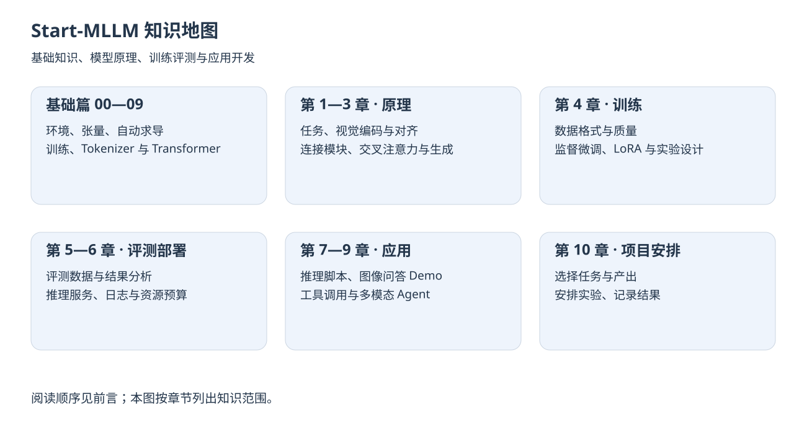

  
   

  <h1>Start-MLLM（⚠️ Alpha内测版）</h1>
  <h3>从零开始学习多模态大模型</h3>
  
<em>从概念、架构、训练到部署，系统搭建你的第一套 MLLM 知识体系</em>

> [!CAUTION]
> ⚠️ Alpha内测版本警告：此为早期构建版本，内容仍在持续补全与调整中，部分章节、示例或表述可能继续变化，欢迎通过 Issue 反馈问题或建议。

  

## 项目介绍

`Start-MLLM` 是一个面向中文学习者的多模态大模型教程项目，定位为“能读懂、能跑通、能继续扩展”的开源学习仓库。

这个项目想做的事情很简单：和大家一起学习，把多模态大模型里那些看起来很吓人的概念、架构和工程问题，一步一步拆成能理解、能上手、能继续延伸的内容。

这份教程不想只停留在“知道一些名词”，而是希望带大家走完一条更完整的学习链路：

1. 先理解什么是多模态大模型，以及它与传统 CV、NLP、LLM 的关系。
2. 再理解视觉编码器、跨模态对齐、投影层和生成式架构是怎么工作的。
3. 接着学习数据、训练、评测、部署与应用设计。
4. 最后亲手跑通一个视觉语言模型，并做一个简单的图像问答 Demo。

如果你有 Python 基础，希望系统入门 MLLM，这个项目就是为你准备的。

当前主线关注图像与文本输入、文本输出的生成式视觉语言模型。音频、视频与多模态生成用于帮助理解整体版图，暂不作为完整的实战路线。

## 你将收获什么

- 系统理解多模态大模型的核心概念、能力边界与主流技术路线
- 理解视觉编码器、CLIP、Projector、Connector、Instruction Tuning 的工程角色
- 学会阅读常见 VLM/MLLM 架构图，并知道它们为什么这样设计
- 了解数据构建、SFT、LoRA、评测基准、部署选型等关键工程问题
- 能够基于 `Transformers` 或 OpenAI 兼容接口跑通图文问答
- 能够进一步把单模态 Agent 扩展成多模态 Agent
- 能够从教程内容过渡到自己的评测脚本、Demo 和小型开源项目

## 项目受众

- 想系统学习多模态大模型的中文学习者
- 已经了解一点 LLM，想进一步理解 VLM / MLLM 的开发者
- 想把图像、文档、截图能力接入自己项目或 Agent 的工程实践者

你可以从这个项目中获得：

- 一条相对完整的 MLLM 入门路径
- 一组可直接上手的代码脚手架
- 一套从理论到实战的章节导航

按学习路线准备：

- **概念阅读与 API 实践**：具备 Python 基础，能安装依赖、运行脚本；不熟悉命令行可先读 [基础篇 00](./docs/foundation/00-环境命令行与Python项目基础.md)。API 实践还需要支持图像输入的可用接口、密钥与调用额度，无需本地 GPU。
- **本地推理**：建议理解 PyTorch 张量的形状、设备与精度，并按示例检查模型兼容性和硬件资源。
- **训练与微调（选学）**：需要进一步学习 PyTorch 训练流程，并准备相应数据与计算资源；不作为首次入门的必做要求。

## 在线阅读

📖 **在线地址**：[https://datawhalechina.github.io/start-mllm/](https://datawhalechina.github.io/start-mllm/)

先读[前言](./docs/前言.md)选择路线：系统学习从[基础篇 00～09](./docs/foundation/README.md)开始，再进入正文；体验 API 可先读第七章，再用第五章检查结果。LLM 基础速通用于复习，专题用于按问题查阅。

> 需要更系统的前置补课？推荐 Datawhale 社区课程：[thorough-pytorch](https://github.com/datawhalechina/thorough-pytorch) · [base-llm](https://github.com/datawhalechina/base-llm) · [self-llm](https://github.com/datawhalechina/self-llm)

## 目录

状态仅表示内容建设进度：✅ 已有章节初稿；🚧 建设中。是否经过实际运行验证，应以相应示例的验证记录为准。

### 基础篇

| 章节名 | 简介 | 状态 |
| ---- | ---- | ---- |
| [基础篇总览](./docs/foundation/README.md) | 为只有 Python 基础的学习者补齐最低工程和模型基础 | ✅ |
| [00 环境、命令行与 Python 项目基础](./docs/foundation/00-环境命令行与Python项目基础.md) | 搞懂路径、终端、pip、conda、环境变量与常见报错 | ✅ |
| [01 向量、矩阵与张量基础](./docs/foundation/01-向量矩阵与张量基础.md) | 手算点积与矩阵乘法，用 CPU 脚本检查视觉特征的形状与批量投影 | ✅ |
| [02 NumPy 基础](./docs/foundation/02-NumPy基础.md) | 理解数组类型、索引、广播、归约与轴变换 | ✅ |
| [03 PyTorch 张量与自动求导](./docs/foundation/03-PyTorch张量与自动求导.md) | 理解设备、计算图、链式法则与梯度累积 | ✅ |
| [04 神经网络与学习过程](./docs/foundation/04-神经网络与学习过程.md) | 理解前向计算、损失、参数更新与泛化 | ✅ |
| [05 Embedding 与 Tokenizer](./docs/foundation/05-Embedding与Tokenizer.md) | 理解文本编码、嵌入、序列长度与对话模板 | ✅ |
| [06 Transformer 基础](./docs/foundation/06-Transformer基础.md) | 理解注意力、位置、残差与自回归生成 | ✅ |
| [07 CV 基础与 ViT](./docs/foundation/07-CV基础与ViT.md) | 理解像素预处理、局部特征与视觉 token | ✅ |
| [08 CLIP 与图文对齐](./docs/foundation/08-CLIP与图文对齐.md) | 理解双塔、对比目标与检索能力边界 | ✅ |
| [09 多模态大模型入口](./docs/foundation/09-多模态大模型入口.md) | 串联视觉编码器、连接器与语言模型 | ✅ |

### 入门导航

| 章节名 | 简介 | 状态 |
| ---- | ---- | ---- |
| [前言](./docs/前言.md) | 全书导读、能力边界、章节依赖与学习建议 | ✅ |
| [Chapter 0 环境准备](./docs/chapter0-环境准备.md) | 环境安装、GPU 自检、API 路线与命令行最小准备 | ✅ |
| [LLM 基础速通](./docs/llm-基础速通.md) | 浏览 Transformer、Token、生成与训练的关键概念，按需补课 | ✅ |
| [术语表](./docs/术语表.md) | 全书高频术语速查 | ✅ |

### 理论篇（第 1～4 章）

| 章节名 | 简介 | 状态 |
| ---- | ---- | ---- |
| [第一章 多模态大模型概览](./docs/chapter1/第一章%20多模态大模型概览.md) | 建立任务地图，理解多模态能力边界与常见误区 | ✅ |
| [第二章 视觉编码器与跨模态对齐](./docs/chapter2/第二章%20视觉编码器与跨模态对齐.md) | 理解视觉 token、CLIP、对齐训练与输入表示 | ✅ |
| [第三章 多模态生成架构](./docs/chapter3/第三章%20多模态生成架构.md) | 对照双塔匹配与生成模型的连接方式，理解 Projector 与训练范式 | ✅ |
| [第四章 数据、训练与微调](./docs/chapter4/第四章%20数据、训练与微调.md) | 了解数据格式、训练流程、LoRA/QLoRA 与最小微调闭环 | ✅ |

### 实战篇（第 5～10 章）

| 章节名 | 简介 | 状态 |
| ---- | ---- | ---- |
| [第五章 评测体系与工程选型](./docs/chapter5/第五章%20评测体系与工程选型.md) | 建立多模态评测意识，跑通最小评测脚本 | ✅ |
| [第六章 推理部署与 Serving](./docs/chapter6/第六章%20推理部署与%20Serving.md) | 理解部署链路、资源规划、性能观测与服务化思路 | ✅ |
| [第七章 动手跑通你的第一个 VLM](./docs/chapter7/第七章%20动手跑通你的第一个%20VLM.md) | 使用 `Transformers` 或 OpenAI 兼容接口跑通图文问答 | ✅ |
| [第八章 构建一个图像问答 Demo](./docs/chapter8/第八章%20构建一个图像问答%20Demo.md) | 基于 `Gradio` 构建最小可交互 Demo | ✅ |
| [第九章 从单模态 Agent 到多模态 Agent](./docs/chapter9/第九章%20从单模态%20Agent%20到多模态%20Agent.md) | 把图像感知、工具调用与工作流连接起来 | ✅ |
| [第十章 学习路线与开源项目实战建议](./docs/chapter10/第十章%20学习路线与开源项目实战建议.md) | 收束全书路线，帮助你继续扩展项目 | ✅ |

### Extra-Chapter

| 章节名 | 简介 | 状态 |
| ---- | ---- | ---- |
| [Extra01 OCR 与文档理解专题](./docs/Extra-Chapter/Extra01-OCR与文档理解专题.md) | 面向票据、合同、截图、版面理解等场景 | ✅ |
| [Extra02 多图输入与比较专题](./docs/Extra-Chapter/Extra02-多图输入与比较专题.md) | 面向商品多图、版本比较、跨图归纳等任务 | ✅ |
| [Extra03 长图处理与切块策略专题](./docs/Extra-Chapter/Extra03-长图处理与切块策略专题.md) | 面向长截图、长网页、长文档输入策略 | ✅ |

## 贡献者名单

| 姓名 | 职责 | 简介 |
| :---- | :---- | :---- |
| [ZXJC-niusile](https://github.com/ZXJC-niusile) | 项目负责人 / 当前唯一贡献者 | 和大家一起学习多模态大模型，把复杂知识拆成能读懂、能跑通的教程 |

## 参与贡献

我们欢迎任何形式的参与，每一条 Issue 和 PR 都会让这份教程变得更好：

- **报告 Bug**：发现内容错误、表达不清、代码跑不通？直接提 [Issue](https://github.com/datawhalechina/start-mllm/issues)，请附上运行环境、复现步骤和报错；维护者会按影响范围逐步处理。
- **提出建议**：对章节结构、学习路径、内容深度有想法？欢迎在 Discussion 或 Issue 中交流。
- **完善内容**：修正示例、补充解释、优化脚手架？欢迎提 Pull Request。
- **贡献实战经验**：把你日常使用 MLLM 的踩坑记录、场景适配经验、评测心得整理成文档，贡献到 `Extra-Chapter`。像社区博客一样，让后来者少走弯路。

## Star History

## 关注我们

扫描下方二维码关注公众号：Datawhale

## LICENSE

 当前仓库中的教程文档与配套示例代码暂统一采用<a rel="license" href="http://creativecommons.org/licenses/by-nc-sa/4.0/">知识共享署名-非商业性使用-相同方式共享 4.0 国际许可协议</a>进行许可。
