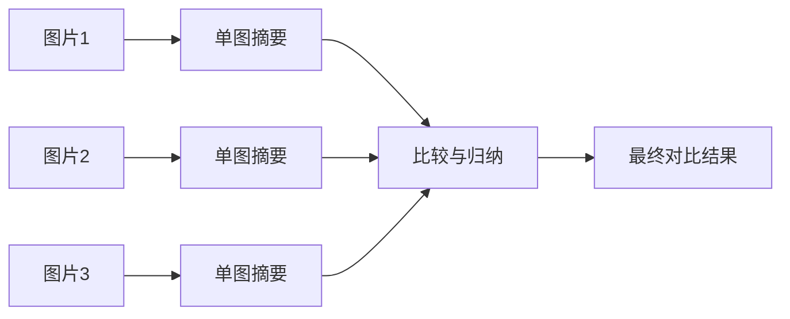

# Extra02 多图输入与比较专题

## 与正文如何对照读

多图 = **输入变长 + 关系变复杂**，正文里建议按下表穿插：

| 正文 | 对照点 |
| --- | --- |
| [第三章 多模态生成架构](../chapter3/第三章%20多模态生成架构.md) | Connector + LLM 下多图如何进 `messages`、是否受上下文长度约束 |
| [第五章 评测](../chapter5/第五章%20评测体系与工程选型.md) | 评测集按“单图 / 多图 / 比较类问题”分 `tags`，单独看失败率 |
| [第六章 部署](../chapter6/第六章%20推理部署与%20Serving.md) | 多图顺序、总像素与超时；区分一次请求内多图和多个独立请求组成 batch |
| [第八章 Demo](../chapter8/第八章%20构建一个图像问答%20Demo.md) | 在单图 Demo 上扩展多图上传与“图1/图2”编号提示 |
| [第九章 Agent](../chapter9/第九章%20从单模态%20Agent%20到多模态%20Agent.md) | 多轮里缓存各图摘要，再交给规划模块做对比 |

若单图细节已经模糊，增加图片数量也未必补回关键证据：可先回顾 [第二章](../chapter2/第二章%20视觉编码器与跨模态对齐.md) 的分辨率与 token。

## 一、为什么多图输入是多模态应用的高频需求

版本比较、多视角观察和时序分析需要在多张图片之间建立对应关系。

典型场景包括：

- 商品多视角展示
- 施工前后对比
- UI 改版前后分析
- 质检中的合格 / 不合格对照
- 医疗或工业中的时间序列变化观察

## 二、多图任务和单图任务的核心差别

单图任务的重点是“图像理解”；多图任务除了图像理解，还要解决：

- 图像顺序
- 跨图对应关系
- 比较维度
- 归纳方式
- 长上下文成本

多图比较与归纳需要处理跨图关系。模型层面的代表性工作是 [LLaVA-NeXT-Interleave](https://arxiv.org/abs/2407.07895)。评测时应检查跨图对应与比较结果。

## 三、常见多图任务类型

### 1. 前后对比

例如“这两个版本界面有什么变化”“装修前后差异在哪里”。

### 2. 多视角归纳

例如同一商品的正面、侧面、细节图，要求总结卖点或判断缺陷。

### 3. 批量筛查

例如一组质检图片中，找出异常样本。

### 4. 时间序列变化

例如多天拍摄的仪表盘、工程现场、植物生长、病灶变化。

## 四、多图输入时最容易踩的坑

### 1. 模型不知道图片顺序

消息中的顺序与模型能否正确建立跨图对应关系是两回事。给每张图注明来源与角色，例如“旧版”“新版”，有助于表达任务；仍需检查回答引用的编号是否正确。

### 2. 比较维度没说清

“比较这两张图”过于宽泛。你应该明确：

- 比较布局
- 比较颜色
- 比较对象数量
- 比较错误信息

### 3. 多图导致上下文过长

图越多，视觉 token 越多，成本和信息噪声也会一起上升。

### 4. 模型把多图混成一张图的整体印象

这会让它忽略局部差异，给出泛化描述，而不是精准比较。

## 五、用编号表达比较任务

建议采用“编号 + 比较维度 + 输出格式”的方式。

例如：

```text
我会提供两张图片：
图 1：旧版页面截图
图 2：新版页面截图

请完成以下任务：
1. 对比两张图在布局上的主要变化
2. 对比按钮和导航结构的差异
3. 用 3 条要点总结新版相对旧版的变化
4. 如果无法确认，请明确说明“不确定”
```

编号和比较维度明确了用户的意图，固定格式方便逐项复核。检查输出时，逐条将差异定位到对应图片。

## 六、直接比较与摘要比较

多图可以在一次请求中共同输入，也可以先分别摘要，再比较摘要。后者适合主要信息能被文字概括、且需要保存中间结果的任务，流程如下：



摘要路线能缩短最终比较阶段的输入，并留下逐图结果；总调用次数和总成本却可能增加。更重要的是，摘要会丢失未被写出的视觉细节。

例如旧版和新版界面只有按钮文字从“提交”变成“保存”，两次摘要都可能写成“右下角有一个操作按钮”。后续比较再仔细也无法从这些摘要恢复差异。若任务关注这种细微变化，应保留原图或相关裁剪供比较步骤读取。

| 方案 | 适用条件 | 主要风险 |
| --- | --- | --- |
| 直接多图输入 | 模型支持多图，总输入在预算内，需要跨图细节 | 图号混淆、长输入成本 |
| 单图摘要后比较 | 关注高层属性，需要独立保存逐图结果 | 摘要遗漏、误差累积 |
| 摘要定位后回读原图 | 先筛选区域，再核验具体差异 | 多次调用与定位错误 |

多张图共同参与一个问题，与把多个互不相关的请求组成 batch 不同。前者需要跨图关联，后者主要是服务调度方式。

## 七、一个实战案例：UI 版本对比助手

UI 版本对比需要保留按钮文字、位置和状态等细节：

1. 将两张原图标为“旧版”和“新版”，共同输入支持多图的模型。
2. 按导航、按钮、表格、弹窗逐项比较，记录差异所在区域。
3. 小字难以辨认时，读取两张图中对应区域的裁剪，并保留原图位置。
4. 对照原图核查差异，再生成总结。摘要可用于定位区域，具体差异由原图或裁剪核实。

你还可以进一步要求输出为固定结构：

```json
{
  "layout_changes": [],
  "button_changes": [],
  "risk_points": [],
  "summary": ""
}
```

这样更适合后续接产品评审或测试流程。

## 八、一个实战案例：商品多图卖点总结

商品图场景特别适合多图输入，因为单张图往往只能看到部分特征。

你可以这样设计：

1. 图 1：正面图
2. 图 2：细节图
3. 图 3：使用场景图

再要求模型：

- 汇总共性卖点
- 描述可见结构和外观；对无法从图片核实的材质、性能与适用性，不写成确定事实
- 输出更接近运营文案的结果

这种任务里，多图比单图更能体现“互补信息”的价值。

## 九、什么时候不适合把所有图片一次性输入

如果出现下面这些情况，建议拆批或分阶段处理：

- 总视觉 token 或像素预算接近接口限制，无法在所需清晰度下同时输入
- 每张图都包含大量小字
- 任务更偏细节抽取，而不是整体总结
- 模型上下文预算有限

可以采用以下候选流程，并在比较阶段保留必要原图证据：

1. 先单图分析
2. 再做摘要压缩
3. 最后再做多图比较

## 十、和主章节的衔接建议

这一专题和下面内容结合最好：

- 第五章：可以单独设计“多图比较测试集”
- 第六章：你会更理解为什么多图会放大推理成本
- 第八章：Demo 可以扩成多图对比工具
- 第九章：Agent 可以先做单图摘要，再做跨图规划

## 十一、章末练习

1. 设计一个“前后版本截图对比”的 Prompt。
2. 举例说明为什么多图任务比单图任务更容易出现混淆。
3. 为一个商品多图任务设计输出 JSON 结构。
4. 思考：如果图片数量从 2 张变成 12 张，你会怎样改工作流？

## 十二、原始论文与深入学习

- **LLaVA-NeXT-Interleave**（2024，[论文](https://arxiv.org/abs/2407.07895)）：研究交错多图、视频和 3D 输入；阅读任务构成与多图评测，区分“输入格式支持”和“关系理解能力”。
- **BLINK**（2024，[论文](https://arxiv.org/abs/2404.12390)）：查看视觉对应、多视角等任务，给本专题的多图比较设计更有针对性的测试。
- **实现文档**：[Qwen2.5-VL 官方模型卡](https://huggingface.co/Qwen/Qwen2.5-VL-3B-Instruct) 的多图示例。第六节“先摘要后比较”是教学工作流，摘要可能丢失差异；应与直接多图输入做对照，比较遗漏、错误与调用成本。
