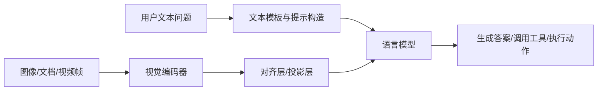
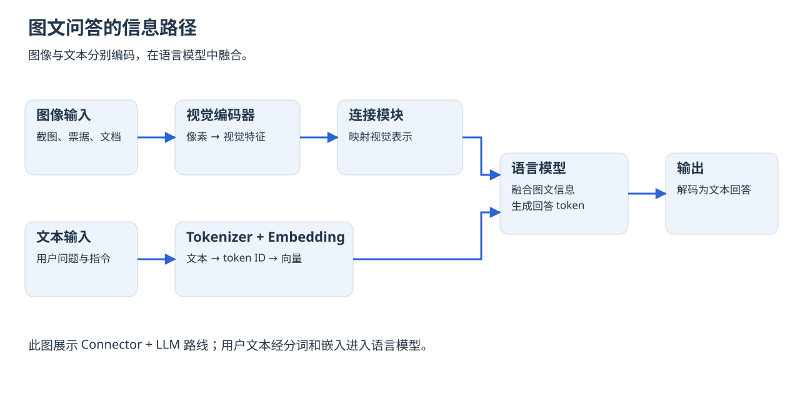

# 第一章 多模态大模型概览


按照[前言](../前言.md)的阅读路线，本章先介绍模块分工与常见任务。像素与 token 的细节见第二章，接入 LLM 生成回答的过程见第三章，调用脚本与应用示例见第七、八章。

## 一、什么是多模态大模型

多模态大模型处理文本、图像、音频或视频等多种信号。图文问答模型接收图片和问题，生成文本回答；其他模型还可以生成图像、音频或动作。

早期生成式视觉语言模型可参考 [GPT-4V 系统卡](https://openai.com/index/gpt-4v-system-card/)和 [Qwen-VL 论文](https://arxiv.org/abs/2308.12966)。[CLIP](https://proceedings.mlr.press/v139/radford21a.html) 属于更广义的视觉语言模型，用于图文匹配，本身不生成回答。

与传统的单模态 LLM 相比，多模态大语言模型（MLLM, Multimodal Large Language Model）增加了处理其他模态的输入路径。在图文问答中，视觉编码器提取图像特征，连接模块将特征接入语言模型，使回答同时依赖图片和问题。

## 二、图像输入提供的信息

截图中的按钮位置、票据版面和商品外观都包含文本输入无法直接提供的信息。处理这类任务，需要读取图像中的相应证据。

## 三、一个多模态系统通常包含哪些模块



在这个最基础的链路里：

- `视觉编码器` 负责把像素信息变成向量表示
- `对齐层/投影层` 负责把视觉特征转换为语言模型可读取的表示
- `语言模型` 负责生成回答、规划步骤、组织输出

第三章将比较投影、压缩与交叉注意力等不同连接方式。

<div align="center">
  
</div>

### 图文问答伪代码

```python
# 1) 准备图像与问题
image = load_image("demo.jpg")
question = "截图里最关键的报错是什么？"

# 2) 图像编码 + 对齐
vision_tokens = vision_encoder(image)
aligned_tokens = connector(vision_tokens)

# 3) 与文本上下文一起送入 LLM
answer = llm.generate(text=question, visual_context=aligned_tokens)
print(answer)
```

## 四、MLLM 和传统 CV、NLP、LLM 的区别

| 类型 | 典型输入 | 典型输出 | 核心目标 |
| --- | --- | --- | --- |
| 传统 CV 模型 | 图像 | 分类标签、框、分割结果 | 识别与定位 |
| 传统 NLP/LLM | 文本 | 文本 | 语言理解与生成 |
| 多模态大模型 | 图像 + 文本 / 文档 + 指令 | 文本、结构化结果、动作计划 | 感知 + 语言推理 |

这里最大的差别在于：传统 CV 模型通常输出固定结构，而多模态大模型更偏向“开放式生成”。这让它更灵活，也更容易出现幻觉、漏看细节、忽略空间关系等问题。

## 五、常见任务

| 任务 | 输入 | 输出与关注点 |
| --- | --- | --- |
| 图像描述 | 图片 | 场景、对象与关系的文字描述 |
| 视觉问答（VQA） | 图片与问题 | 根据问题提取图像证据并回答 |
| OCR 与文档理解 | 票据、合同、截图、表格 | 文字、字段和版面关系 |
| 图表与数学推理 | 图表或数学题图片 | 读取元素，进行比较、计算与推理 |

多模态 Agent 是组合这些任务与工具的系统形态，涉及多轮上下文、任务规划和执行。描述准确的模型仍可能漏读小字，任务表现应分别评测。

## 六、影响图像理解的因素

图像理解受以下因素影响：

1. 视觉编码器有没有保留足够的信息。
2. 对齐过程有没有把视觉语义成功映射到语言空间。
3. 训练数据里有没有覆盖你关心的场景。
4. 推理阶段有没有因为裁剪、分辨率、压缩或模板问题丢失关键信息。

## 七、常见错误

1. **换图后答案不变**：例如换成一张没有猫的图片，回答仍然是“图片里有一只猫”。
2. **遗漏细节**：能概括主题，但看漏小字、按钮名、字段值。例如报错截图中把 “Error 404” 看成 “Error 40 4”，或忽略右下角的版本号小字。
3. **推理错误**：读出了元素，却在比较、归纳、因果判断上出错。比如能认出多个按钮，但无法判断哪个是“确认”操作。

排查时分别检查输入质量、视觉特征和推理链路，再用对照实验缩小原因范围。这些案例在 [第二章](../chapter2/第二章%20视觉编码器与跨模态对齐.md) 的 Debug 清单和 [第五章](../chapter5/第五章%20评测体系与工程选型.md) 的评测脚本里都会反复出现。

## 八、代码入口

下面列出对应的代码入口，可按函数名和变量名定位：

- `docs/chapter7/code/transformers_chat.py`：在 `main()` 里搜 `messages = [`，看 `content` 里 `image` 与 `text` 如何并列；再搜 `apply_chat_template`（多轮格式与生成提示）、`process_vision_info` 与 `processor`（像素如何进入视觉分支）——对应第三节伪代码里的 `vision_encoder` 与进入 LLM 之前的张量准备。
- `docs/chapter7/code/openai_compatible_client.py`：在 `main()` 里搜 `OpenAI(`、`to_data_url` 与 `chat.completions.create`，看 `messages` 里的 `image_url`（`data:` URL）；这是服务化时最常见的协议形态，字段缺失或顺序不符时往往在服务端报 400/422 一类错误（[第二章](../chapter2/第二章%20视觉编码器与跨模态对齐.md) Debug 清单会再对照）。
- `docs/chapter8/code/app.py`：搜 `chat.completions.create` 及其 `messages` 结构，是第七章脚本在 Gradio 里的“产品化”版本；习惯上应与 [第五章](../chapter5/第五章%20评测体系与工程选型.md) 中 `eval_vlm_dataset.py` 的发送方式一致，离线评测与线上 Demo 才能互相复现同一类失败。

## 九、章末练习

### 必做（5-10 分钟）

1. 以截图问答为例，说明图像和用户问题分别提供什么信息，以及视觉编码器、连接模块与语言模型各自的作用。
2. 任选一个场景，写出输入模态、主要证据、输出形式和核心难点，并判断它属于哪类任务。

### 进阶（20-30 分钟）

1. 解释为什么一个能回答自然图像问题的模型，不一定能做好文档理解。
2. 对同一张图提出 3 个不同类型问题（描述/细节/OCR），记录模型回答差异。

### 挑战（1-2 小时）

1. 列出你最想做的 1 个多模态项目，并说明它更需要“感知”“推理”还是“工具调用”。
2. 为该项目写一个“失败模式清单”（至少 5 条）和对应兜底（fallback）思路。

## 十、本章小结

- 图文问答需要同时利用图片证据与用户问题
- 本章采用视觉编码器、连接模块和语言模型描述常见图文生成架构
- 分析任务表现时，需要检查视觉表征、训练数据和推理链路

### 原始资料与阅读顺序（选读）

1. **匹配和生成有何不同？** Radford 等，2021，[CLIP: Learning Transferable Visual Models From Natural Language Supervision](https://proceedings.mlr.press/v139/radford21a.html)：看图文双塔与训练目标，第二章会展开。
2. **图像如何接入语言模型？** Bai 等，2023，[Qwen-VL](https://arxiv.org/abs/2308.12966)：看 §2 的模型组成与输入输出，第三章再比较连接方式。
3. **产品的视觉能力有哪些限制？** OpenAI，2023，[GPT-4V(ision) system card](https://openai.com/index/gpt-4v-system-card/)：这是开发方系统卡，用于了解评测与风险，不是公开完整架构的论文。

## 十一、章节跳转

- 上一篇：[前言](../前言.md)
- 下一篇：[第二章 视觉编码器与跨模态对齐](../chapter2/第二章%20视觉编码器与跨模态对齐.md)
- 延伸实践（实战篇）：[第七章 动手跑通你的第一个 VLM](../chapter7/第七章%20动手跑通你的第一个%20VLM.md)
