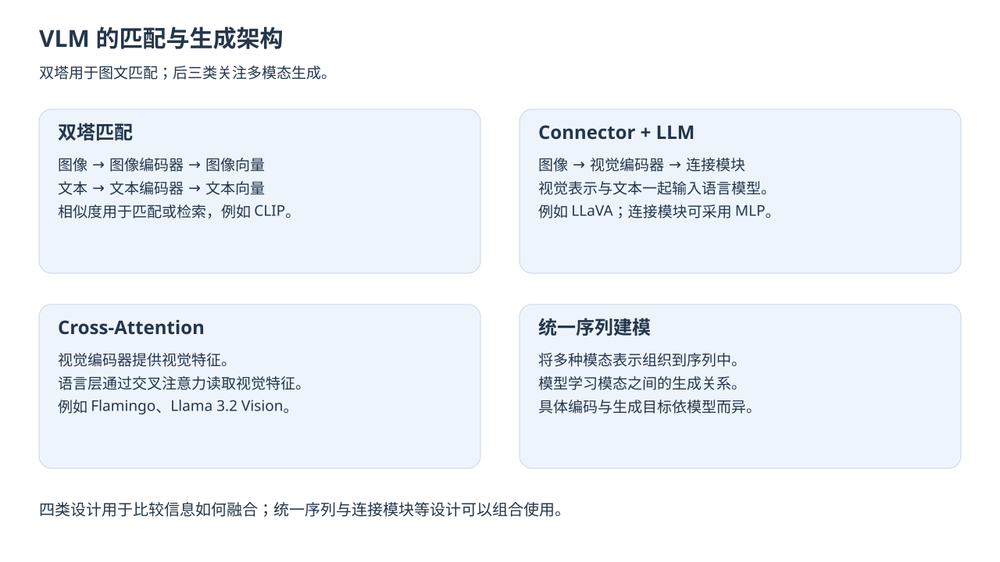

# 第三章 多模态生成架构


承接 [第二章](../chapter2/第二章%20视觉编码器与跨模态对齐.md)：视觉编码器已经把像素变成特征，本章解决下一步：**这些特征在哪里参与语言计算，答案的训练信号又怎样传回连接模块？**

本章在基础篇 [09 MLLM 入口](../foundation/09-多模态大模型入口.md) 上进一步追踪标签位置、连接器参数和真实架构的连接位置。基础篇回答“各模块做什么”，这里回答“具体怎样连接、怎样监督、不同设计如何取舍”。

## 一、学习目标：沿着一条答案追踪信息

建议先完成 [基础补课](../foundation/README.md) 的张量知识、[LLM 基础速通](../llm-基础速通.md) 和第二章的视觉 token。读完本章，你应能不看模型宣传图完成四件事：

1. 从图像尺寸写到视觉特征、LLM 输入、输出 logits 与 labels 的形状。
2. 手算一个 Connector 的参数量，解释它是否压缩 token，以及为什么“能做矩阵乘法”不等于“看懂图像”。
3. 区分输入层拼接、LLM 内交叉注意力、Q-Former 压缩；指出 cross-attention 究竟发生在哪里。
4. 对照 BLIP-2 与原始 LLaVA，写出每个阶段的目标、冻结参数和可训练参数，而不是只背“两阶段”。

本章的主线是一张“红色方块”图片和问题“什么颜色？”。前半章用人为缩小的维度手算机制，后半章才对照真实论文。**示例数值不是任何发布模型的配置，玩具特征也不是实际编码器学到的语义坐标。**

## 二、走通一次：图像到输入、标签与答案

先选最容易追踪的结构：视觉编码器 → 逐 token 线性投影 → decoder-only LLM。它在 LLM 输入层拼接视觉与文本 embedding；这里的“早期拼接”仅指进入语言解码器之前，并非把原始像素与文字直接混合。

### 2.1 每一个轴代表什么

设 batch B=1，RGB 图像为 28×28，patch 边长为 14。为便于手算，假设视觉编码器只返回 patch 特征，不保留 CLS token；视觉宽度 d_v=3，语言宽度 d_l=4。

| 步骤 | 形状 | 该步骤的变换 |
| --- | --- | --- |
| 预处理后图像 | [1, 3, 28, 28] | 通道、像素；还不是语言 token |
| 视觉编码器输出 X | [1, 4, 3] | (28/14)×(28/14)=4 个 patch，每个用 3 个数表示 |
| Connector 输出 Z | [1, 4, 4] | 每个视觉 token 的宽度从 3 变为 4，数量仍为 4 |
| 文本前缀 embedding P | [1, 3, 4] | 假设问题及必要边界合计 3 个 token，由词表查表得到 |
| 拼接后的推理输入 [Z; P] | [1, 7, 4] | 沿序列轴连接，不是把宽度变成 8 |
| 最后一位置的 logits | [1, V] | V 是文本词表大小；预测第一个答案 token |

本例预设“什么颜色？”占三个 token，以便追踪形状；实际切分由 tokenizer 决定。视觉 token 是连续向量，不必先变成文本词表中的整数 ID；代码中的 `<image>` 也常是展开视觉 embedding 的占位符，不表示整张图永远只占一个位置。

LLM 的因果自注意力让当前位置读取此前可见的视觉与文字。推理时取前缀最后一个位置的输出，选出答案 ID，查它的 embedding，继续预测下一个 ID，直到停止标记或长度上限。这里**生成的是文本 token，不是把视觉 token 逐个翻译成汉字**。

### 2.2 训练时为什么答案也在输入里

设答案分为 a1、a2、EOS 三个 token。训练采用 teacher forcing：一次前向同时输入正确的答案前缀，用因果遮罩禁止看未来；不用等模型逐字采样。这是 [LLM 基础速通](../llm-基础速通.md) 中 next-token prediction 在多模态输入上的延伸。

```text
位置               0  1  2  3  4  5  6  7   8   9
输入 embedding     v1 v2 v3 v4 p1 p2 p3 a1  a2  EOS
未移位 labels      ×  ×  ×  ×  ×  ×  ×  a1  a2  EOS
真正比较           logits[6]→a1, logits[7]→a2, logits[8]→EOS
```

此时输入是 [1,10,4]，完整 logits 为 [1,10,V]，未移位 labels 为 [1,10]。“×”表示不计入损失，常用实现以 -100 表示，但这只是损失函数约定，绝不是词表中的 token。

常见 causal-LM 实现会在内部比较 logits[:-1] 与 labels[1:]。因此 labels[7]=a1 已经足够，**不要在数据处理和模型内部各移位一次**。本例只平均三个有效目标的负对数概率：若它们分别为 0.5、0.25、0.5，loss = (-ln 0.5 - ln 0.25 - ln 0.5)/3 ≈ 0.924。

视觉和用户前缀虽然不作为预测目标，仍然是答案的条件。**loss mask 与 attention mask 不是同一张遮罩**：把视觉位置的 label 忽略，不会禁止答案看图。原始 LLaVA 的答案与停止符监督可核对 [论文 §4.2、表 2](https://arxiv.org/html/2304.08485v2#S4.SS2)。

停下来检查：如果把所有 labels 都设成忽略，模型即使前向能输出文字，也没有本样本的有效训练信号；如果只喂问题和图片，却把答案的形状硬接到 labels 上，则应先检查序列构造，而非换 Connector。

## 三、手算 Connector：改变宽度，不等于改变语义

### 3.1 一个能逐项检查的线性层

约定 token 是行向量，线性层为 Z = XW + b。W 的形状是 [d_v,d_l]，偏置 b 是 [d_l]，对每个 token 复用同一组参数。某些框架存储权重为 [d_l,d_v]，前向会转置；不要把存储约定误当架构不同。

```text
x = [1, 2, 0]
W = [[1, 0, 1,  0],
     [0, 1, 0, -1],
     [1, 1, 0,  0]]
b = [0, 0, 0, 1]
xW + b = [1, 2, 1, -1]
```

3→4 的层有 3×4+4=16 个参数。四个 token 共用这 16 个参数，而不是 4×16 个；batch 或图像 token 增加会增加计算量，不会增加这个层的参数量。

若改为 3→6→4 的两层 MLP，并在中间加非线性激活：参数量为 (3×6+6)+(6×4+4)=52。形状依次是 [1,4,3] → [1,4,6] → [1,4,4]。中间非线性使它不再只是一个可合并的线性映射；**逐 token MLP 本身不会让四个 token 相互注意，也不会把四个变成两个**。视觉编码器之前可以已经混合过 patch 信息，别把“Connector 不混合”误读成“整个系统没有空间交互”。

作为规模换算，1024→4096→4096、两层均有偏置的 MLP 有 20,979,712 个参数，无论处理 256 还是 576 个视觉 token 都不变。[LLaVA 初版](https://arxiv.org/html/2304.08485v2#S4.SS1) 是线性投影，[LLaVA-1.5 §3.3](https://arxiv.org/html/2310.03744v2#S3.SS3) 才改为两层 MLP，不应混写。

### 3.2 形状兼容，却把红色说成蓝色

人为定义两个特征：红=[1,0]、蓝=[0,1]。再人为规定下游读出器将坐标 1 解释为“红”、坐标 2 解释为“蓝”。比较两个 2→2 Connector：

```text
W_good = [[1,0], [0,1]]    红 → [1,0] → 红
W_swap = [[0,1], [1,0]]    红 → [0,1] → 蓝
```

两者参数量相同、形状完全合法，却语义相反。甚至把所有图片都投影成零向量也不会触发 shape error，语言模型仍可能依赖问题和常见答案流畅作答。这就是为什么只测“程序跑通”和“句子通顺”不够。

这个反例证明的是接口兼容不足以保证有用映射；真实 LLM 的语义分布在很多维度里，不存在手工指定的单个“红色轴”。训练用答案损失约束 Connector：与视觉证据一致的答案应得到更高概率。可用原图、换图、遮图三个条件比较输出或正确答案概率，判断模型是否利用图像；变化与否只是诊断证据，不能单次实验便断言某个模块损坏。

## 四、输入拼接与内部交叉注意力：问清“在哪里看图”

双塔模型输出图文相似度，适合匹配和检索；它本身没有逐 token 的语言生成链路。从双塔到生成模型，不是把两个向量相加，而是提供视觉条件和文本预测目标。

对生成系统，先把两个维度分开：**Connector 怎样加工视觉特征**，以及**加工后的特征在哪里进入语言计算**。它们不是互斥的模型门派。

### 4.1 LLM 输入层拼接

第二节已经走通此路线。每个视觉向量先变成 d_l 维，再与文本 embedding 拼接，由语言模型自注意力融合。Connector 可以是线性层、MLP，也可以是带 query 的压缩模块。因此“用了 cross-attention 的 Connector”不等于“改造了 LLM 内部”。例如 [Qwen-VL §2](https://arxiv.org/abs/2308.12966) 用 query-based cross-attention 适配器后再接入语言模型，不能统称为 MLP。

在单头、忽略 batch 的示意中，N 个视觉 token 加 T 个文本 token，完整自注意力分数矩阵为 [N+T,N+T]；生成时通常通过 KV cache 避免重算全部前缀，但视觉位置仍影响缓存和上下文预算。

### 4.2 Flamingo：视觉留在另一条支路

[Flamingo §3.1](https://arxiv.org/html/2204.14198v1#S3.SS1) 先用 Perceiver Resampler 将视觉特征变成固定数量的向量，论文采用 64 个；再把新训练的 gated cross-attention/dense 模块插到冻结语言模型的层之间。原有视觉编码器与原有语言层冻结，Resampler 和新增模块可训练。

用简化的单头形状追踪：文本隐藏状态 H=[T,d_l] 产生 Q=[T,d_k]；视觉支路 R=[M,d_r] 分别投影出 K=[M,d_k]、V=[M,d_value]。这里 d_value 表示注意力 value 的宽度，不是前文视觉编码器的 d_v。于是：

```text
Q 乘 K 的转置： [T,d_k] × [d_k,M] → [T,M]
沿 M 归一化：   每个文本位置对 M 个视觉位置分配注意力
注意力 × V：   [T,M] × [M,d_value] → [T,d_value]
输出投影：     [T,d_value] → [T,d_l]，再回到文本残差流
```

这里 Q 来自文字、K/V 来自视觉，两侧 token 数不必相同。Flamingo 用门控让新增分支在初始化时贡献为零，再在训练中学会加入视觉信息；细节见论文 §3.1.2。

**视觉向量不逐个占用语言自注意力的位置，不等于图片没有成本、上下文无限长。** 新增交叉注意力有 T×M 的分数、视觉缓存、编码和重采样成本；文字序列里的图像标记也仍占位置。原论文还用跨模态遮罩限定直接可见的图像，不能把结构图画成“每个词任意看所有图片”。

## 五、Q-Former：学会压缩，再把结果交给 LLM

[BLIP-2 §3](https://arxiv.org/html/2301.12597v3#S3) 的 Q-Former 是语言模型外面的连接模块。它用可学习 query 从视觉特征中提取信息，包含 query 间自注意力及对视觉特征的交叉注意力；“query”在这里是可训练向量，不是用户问题文本。

以原论文的 ViT-L/14 视觉特征示例为起点，形状链为（不是所有视觉骨干都输出 257×1024）：

```text
视觉特征         [B,257,1024]
32 个 query 经 Q-Former 读取视觉特征
query 输出       [B,32,768]
全连接映射       [B,32,d_l]
作为视觉 soft prompt 接到 LLM 输入
```

32 个初始 query 是跨样本共享的参数，但它们读完不同图片后的输出不同。参数共享不意味着每张图都得到相同的视觉提示。压缩把 257 个位置汇总为 32 个，在进入 LLM 前减少位置数；它也形成信息瓶颈，模型必须学会保留对训练任务有用的信息，小字和局部细节可能在压缩中丢失。

因此 BLIP-2 同时用了“交叉注意力连接器”和“LLM 输入 soft prompt”。Flamingo 则把交叉注意力加在语言模型内部。只看到架构图上写着 Cross-Attention，无法判断后续序列长度和需修改哪些语言层。

BLIP-2 接 OPT 时可以用第二节的 decoder-only 思路理解；接 FlanT5 时是 encoder-decoder 结构，视觉提示与前缀进入 encoder，decoder 生成后缀，不能把第二节的单一因果序列不加修改地套过去。

## 六、两种“两阶段”：目标相同吗，谁真的在更新？

下表只描述对应论文的预训练/指令训练方案，不代表所有后续微调与衍生模型。

| 方案与阶段 | 视觉编码器 | 连接模块 | 预训练 LLM | 目标与数据 |
| --- | --- | --- | --- | --- |
| BLIP-2 阶段 1 | 冻结 | 训练 Q-Former、query 与任务头 | 尚未接入 | 图文对上的表示学习：ITC、ITM、ITG |
| BLIP-2 阶段 2 | 冻结 | 训练 Q-Former/query 与到 LLM 的全连接层 | 冻结 | 让 LLM 在视觉提示条件下生成文本 |
| 原始 LLaVA 阶段 1 | 冻结 | 训练线性投影 | 冻结 | 图文对改为简短描述问答，预测 caption |
| 原始 LLaVA 阶段 2 | 冻结 | 继续训练线性投影 | 更新 | 视觉指令对话，预测助手答案与停止符 |
| Flamingo 主训练 | 冻结 | 训练 Resampler、新增 gated cross-attention/dense 模块 | 原有语言层冻结 | 图文交错等数据上的条件文本生成 |

来源：[BLIP-2 §3.2–3.3](https://arxiv.org/html/2301.12597v3#S3.SS2)、[LLaVA §4.2](https://arxiv.org/html/2304.08485v2#S4.SS2)、[Flamingo §3](https://arxiv.org/html/2204.14198v1#S3)。

BLIP-2 的三个缩写各自回答不同问题：ITC 比较配对与不配对图文的表示；ITM 判断具体图文对是否匹配；ITG 在视觉条件下预测文本。阶段 1 的文本生成发生在 Q-Former 的文本分支，不是已经在训练后面的 LLM。阶段 2 才把它接到冻结 LLM 上。因此 **BLIP-2 的“表示学习→生成学习”不等于 LLaVA 的“特征对齐→指令微调”**。

LLaVA 的两个阶段都使用自回归文本预测；变化在训练数据、任务范围和更新参数，不能写成“阶段 1 优化图文余弦相似度，阶段 2 才开始预测答案”。指令样本让同一张图对应“描述内容”“只回答颜色”“按指定格式输出”等不同要求，而不只是泛泛生成 caption。

### 冻结参数不等于切断计算图

若只训练 Connector，答案损失仍需沿 LLM 计算传回 Connector 输出，再更新它的权重。冻结 LLM 表示不更新它的参数；如果把整个 LLM 前向放在禁用梯度的上下文中，通常也切断了 Connector 需要的梯度。

反过来，冻结且前面没有可训练模块的视觉编码器通常可以无梯度提取特征。若给视觉输入前加入可训练模块，又须重新判断。**先画“loss → 哪个可训练参数”的路径，再决定在哪里停止梯度**。冻结也不等于没有 LLM 前向、激活或显存成本。

## 七、原生统一：看公开结构，不靠名字补全

“原生多模态”或“统一建模”通常强调多种模态的联合训练与建模，**不能据此推断模型没有视觉编码或图像 Tokenizer，也不代表这些模型共享一种内部结构**。例如，[Chameleon 论文 §2.1](https://arxiv.org/html/2405.09818v1#S2.SS1) 使用专门训练的图像 Tokenizer 将图片转为离散 token，再与文本 token 共同建模；这与直接把原始像素送进语言模型不同。

[Gemini 1.0 论文 §2](https://arxiv.org/html/2312.11805v3#S2) 说明其视觉编码借鉴 Flamingo、CoCa 和 PaLI，并强调从训练之初就是多模态。[GPT-4o 官方介绍](https://openai.com/index/hello-gpt-4o/) 则公开说明文本、视觉和音频由同一神经网络端到端处理；仅凭这一说明，不能补推未披露的视觉前端细节。阅读这类模型时，应分别核对输入如何编码、何处融合、支持哪些输出，以及哪些结构细节已经公开。

对照第二节：连续视觉 embedding 与离散图像 token 是两种表示方式；是否能生成图像，还取决于输出词表/预测头、解码器与训练目标。**“接受图片”不能推出“能输出图片”，“统一”也不能推出“所有位置使用相同损失”。**

## 八、把比较压缩成可核对的架构笔记

<div align="center">
  
</div>

图用于定位大类，不能替代参数和形状核对。可沿以下五行拆一个模型仓库：

- 输入与视觉输出：分辨率、是否切块/多图、保留哪层特征、N 与 d_v 是多少。
- 连接器：逐 token 投影，还是 query/重采样？输出 N' 与 d_l 是多少。
- 融合位置：输入层 soft prompt，还是语言模型内部交叉注意力？需要哪些遮罩。
- 训练：逐阶段列冻结/更新参数，监督哪些位置，用什么目标。
- 输出：文本词表还是其他模态预测头；推理模板与训练是否一致。

“细节未公开”也是有效答案。不能因为能调用一个 OpenAI 兼容接口，就推断其内部 Connector。

## 九、工程取舍：token 预算比门派标签更有用

| 结构 | 你得到什么 | 你仍需付出的代价 |
| --- | --- | --- |
| 双塔匹配 | 可直接对图文表示排序 | 自身不提供开放文本生成 |
| 逐 token 投影后拼接 | 保留全部所选视觉位置，语言层改动少 | N 个视觉位置进入语言上下文与缓存 |
| query 压缩后拼接 | 用 M 个视觉位置替代 N 个，M 通常更小 | 压缩模块计算、训练与可能的信息丢失 |
| 语言层内交叉注意力 | 视觉向量不逐个塞入语言自注意力序列 | 新增层、视觉缓存、交叉注意力及遮罩实现 |
| 统一多模态建模 | 可围绕多种模态共同设计输入输出与目标 | 必须查具体编码、序列长度、训练数据与输出机制 |

例如一个接口最多容纳 2,048 个位置，文本前缀用 300 个，最多生成 100 个 token。若每张图映射为 576 个位置，不计其他标记时，两图共 1,552 个位置可容纳，三图共 2,128 个则超限。换成每图 32 个压缩位置可以减轻此处预算，同时需要评测压缩前后的 OCR 准确率，检查是否丢失任务证据。多图设计见 [Extra02](../Extra-Chapter/Extra02-多图输入与比较专题.md)。

## 十、从架构到数据：同一张图为何需要不同样本

对“红色方块”可以写三个不同监督：描述任务回答“一个红色方块”；颜色任务回答“红色”；指定 JSON 格式任务回答颜色字段。它们使用同一幅图，却要求不同答案。数据中的问题、视觉证据与目标必须对应，答案位置的 loss mask 也必须正确。

反例：把蓝图误配到“红色”答案上，shape 检查全部能过，优化器还会认真提高错误答案的概率。连接器容量再大也不能自动纠正这种系统性标签错误。样本格式、数据质量与训练配置在 [第四章](../chapter4/第四章%20数据、训练与微调.md) 展开，本章不重复一套数据脚本。

## 十一、故障推理：先验证哪条假设

| 观察到的现象 | 优先检查 | 不能直接得出的结论 |
| --- | --- | --- |
| 拼接时报宽度不匹配 | d_v→d_l 映射、拼接轴、选取的特征层 | “这个视觉模型不适合此任务” |
| loss 能算但 Connector 梯度不存在 | 冻结与禁用梯度的边界、detach、参数是否接入前向 | “LLM 冻结就无法训练 Connector” |
| 换成另一张图仍总答红色 | 视觉是否真的进入前向、数据偏差、遮罩、条件对照 | “一定是 Connector 参数太少” |
| 描述流畅却不遵守只答颜色 | 指令数据、模板、labels，验证集上的任务行为 | “需要换成原生统一架构” |
| 分辨率提高后更慢或超上下文 | 切块数量、N'、语言缓存与输出预留 | “参数量一定增加了” |

训练 loss 下降只能说明当前监督目标更容易拟合，不能单独证明视觉证据被正确使用。先固定模型和任务做可解释对照，再考虑扩大模型或重做架构。

## 十二、无 GPU 的结构拆解作业

选第十四节一个资料公开的模型，只查论文与配置，不下载权重。交付一页笔记：一条形状链、一张冻结表、一条预算计算、一项有依据的局限。每个具体配置附上版本和出处，不知道的维度明确写“待查”。

验收标准：另一个读者能据你的笔记指出视觉信息进入语言计算的准确位置，并复算 token 总数；只抄模型名、榜单成绩或“效果很好”不算完成。模型运行与推理服务留到第七章。

## 十三、章末练习与推理答案

先独立写答案，再展开核对。每题都对应本章目标，不需要安装框架。

1. B=2、N=16、d_v=8、d_l=12；逐 token 线性层带偏置，文本前缀长 5。写出投影和拼接形状、参数量。N 变为 64 后什么改变？
2. 第二节把视觉 labels 设为忽略，是否会让视觉 Connector 没有梯度？为什么不能将整个冻结 LLM 包在禁用梯度的上下文里？
3. 一个 8→8 的矩阵输出形状完全正确。能否宣布完成对齐？给出失败构造，并设计一个条件对照。
4. 某图写着“32 queries → Cross-Attention → FC → frozen LLM”。能否认定它是 Flamingo？还缺什么证据？
5. 复述 BLIP-2 与原始 LLaVA 的第二阶段，至少分别写出目标、LLM 是否更新；解释为什么两者都叫“两阶段”仍不可互换。
6. 语言总预算 1,024，文本前缀 200，生成上限 56，两图各 400 个视觉位置。能否直接拼接？若改成 query 压缩每图 32 个，预算与风险分别是什么？

<details>
<summary>参考答案：重点看推理，不只核对数字</summary>

1. 投影 [2,16,12]，拼接 [2,21,12]；参数 8×12+12=108。N=64 时投影 [2,64,12]，拼接 [2,69,12]，仍是 108 个参数，但计算、激活和后续注意力成本增加。逐 token 线性层没有压缩 N。
2. 不会必然断梯度。答案概率依赖视觉输入，答案 loss 可经 LLM 回传到 Connector。冻结只不更新 LLM 权重，禁用整个前向的梯度则会切断上游路径。还要检查实际参数是否确实影响答案，不能只靠这段理论保证非零梯度。
3. 取全零矩阵，所有图片输出一样；或将已学映射的两个语义方向交换。可保持问题不变，换成答案应不同的图片，比较正确答案的概率/输出。若输出不变，应继续检查数据和输入链路；它不是一次就能定位根因的证明。
4. 不能。query 的交叉注意力可以发生在 LLM 外部，BLIP-2 就是这种情况。需要检查 FC 后是否作为输入 soft prompt，还是视觉 K/V 注入语言层；还需训练目标与确切版本才能识别具体模型。
5. BLIP-2 阶段 2 用视觉提示条件下的文本生成目标训练 Q-Former 与映射，LLM 冻结。原始 LLaVA 阶段 2 用指令答案监督更新投影与 LLM，视觉编码器冻结。前者是生成预训练衔接，后者是视觉指令微调；同为两个步骤不是相同课程或参数策略。
6. 200+56+2×400=1,056，超出 32；压缩后为 200+56+2×32=320，剩余 704，尚未计入额外模板/图像标记。预算合格只是可运行条件，细小文字或多目标证据可能在压缩时丢失，要用对应任务评测验证。

</details>

## 十四、代表性开放权重 VLM（按所列版本速查）

下面按所列版本对照视觉前端、连接方式和资料入口，并非最新模型排行榜。模型名中的参数规模常是语言基座或系列标称值，不一定等于全模型参数量；MoE 还要区分总参数与激活参数。

> 资料核对日期：2026-10-10。模型名链接优先指向对应原论文/技术报告，没有对应论文入口时明确标为官方模型卡或发布说明。权重许可与代码许可分别核对；“开放权重”不等于统一的开源或商用许可。

| 模型与原始资料 | 规模口径 | 视觉编码器 | Connector / 融合 | 权重许可入口 | 重点结构 |
|---|---|---|---|---|---|
| [**Qwen2.5-VL**](https://arxiv.org/abs/2502.13923) | 标称 3B / 7B / 32B / 72B | ViT | MLP | 依规模不同，见下方说明 | 动态分辨率、视频时间定位 |
| [**InternVL2.5**](https://arxiv.org/abs/2412.05271) / [**3**](https://arxiv.org/abs/2504.10479) | 标称 1B～78B，按版本核对 | InternViT | MLP | [模型卡及基座条款](https://huggingface.co/OpenGVLab/InternVL3-1B#license)，不能整个系列统称 Apache 2.0 | Pixel-shuffle、动态高分辨率切块 |
| [**LLaVA-NeXT（发布说明）**](https://llava-vl.github.io/blog/2024-01-30-llava-next/) / [**OneVision（论文）**](https://arxiv.org/abs/2408.03326) | 随基座而变；OneVision 含 0.5B / 7B / 72B 基座版本 | CLIP / SigLIP，依版本 | MLP | 按具体权重核对，例如 [OneVision-7B](https://huggingface.co/lmms-lab/llava-onevision-qwen2-7b-ov) 为 Apache 2.0 | AnyRes；OneVision 统一单图、多图与视频任务 |
| [**MiniCPM-V 2.6（官方模型卡）**](https://huggingface.co/openbmb/MiniCPM-V-2_6) | 全模型约 8B，不是 2.8B 版本 | SigLIP-400M | Query-based Resampler | [MiniCPM Model License](https://huggingface.co/openbmb/MiniCPM-V-2_6#license)；代码为 Apache 2.0 | 视觉 token 压缩、多图与视频 |
| [**DeepSeek-VL2**](https://arxiv.org/abs/2412.10302) | Tiny / Small / 完整版激活参数为 1.0B / 2.8B / 4.5B；不是总参数 | SigLIP | MLP；MoE 位于语言模型 | [DeepSeek Model License](https://huggingface.co/deepseek-ai/deepseek-vl2#4-license)；代码为 MIT | 动态切块、MoE 语言模型 |
| [**Pixtral 12B**](https://arxiv.org/abs/2410.07073) | 12B 解码器 + 约 400M 视觉编码器 | Pixtral ViT | 两层全连接网络（GELU） | [Apache 2.0](https://huggingface.co/mistralai/Pixtral-12B-2409) | 原生宽高比、多图输入 |
| [**Llama 3.2 Vision（官方模型卡）**](https://huggingface.co/meta-llama/Llama-3.2-11B-Vision-Instruct) | 标称 11B / 90B | 独立图像编码器 | Cross-Attention | [Llama 3.2 Community License](https://huggingface.co/meta-llama/Llama-3.2-11B-Vision-Instruct#model-information) | 视觉适配器接入 Llama 3.1 |
| [**NVLM-D-72B**](https://arxiv.org/abs/2409.11402) | 72B 语言基座；这里专指 D 版 | InternViT | MLP | [CC BY-NC 4.0，另有基座条款](https://huggingface.co/nvidia/NVLM-D-72B#licenseterms-of-use) | D 版为 decoder-only；不要将其配置代表论文全部变体 |
| [**Phi-4-multimodal**](https://arxiv.org/abs/2503.01743) | 全模型约 5.6B | SigLIP-400M 经 LLM2CLIP 微调 | 视觉侧两层 MLP；语言侧使用模态 LoRA | [MIT](https://huggingface.co/microsoft/Phi-4-multimodal-instruct) | 图像与语音输入、文本输出 |
| [**Qwen2.5-Omni**](https://arxiv.org/abs/2503.20215) | 此处对应 7B 发布版本 | ViT（视觉侧） | Thinker–Talker，不宜只概括为视觉 MLP | [Apache 2.0](https://huggingface.co/Qwen/Qwen2.5-Omni-7B) | 图文音视频输入，文本与语音输出 |

**Qwen2.5-VL 的许可须分版本看**：[3B](https://huggingface.co/Qwen/Qwen2.5-VL-3B-Instruct/blob/main/LICENSE) 是 Qwen Research License，[7B](https://huggingface.co/Qwen/Qwen2.5-VL-7B-Instruct) 与 [32B](https://huggingface.co/Qwen/Qwen2.5-VL-32B-Instruct) 标注 Apache 2.0，[72B](https://huggingface.co/Qwen/Qwen2.5-VL-72B-Instruct/blob/main/LICENSE) 是 Qwen License。这里仅记录来源，不代替阅读完整条款。

**按问题读论文**：分辨率与视觉压缩可选 Qwen2.5-VL、InternVL 或 MiniCPM 的对应资料；MoE 的总参数/激活参数区别看 DeepSeek-VL2；需要语音输入输出时比较 Phi-4-multimodal 与 Qwen2.5-Omni，避免把“支持音频输入”理解成“一定能生成语音”。表中 SigLIP 的方法来源是 Zhai 等的 [Sigmoid Loss for Language Image Pre-Training](https://arxiv.org/abs/2303.15343)（2023）。

### 怎么快速选模型

如果你是第一次选 VLM，建议按这个顺序决策：

1. **先固定运行预算与配置**：选型时核对全模型参数量，例如 MiniCPM-V 2.6 约为 8B。显存还取决于权重精度、视觉 token、上下文和运行时开销；按第零章的方法估算，再用目标配置测量。
2. **再看任务类型**：文档/OCR 密集 → InternVL、MiniCPM-V；通用对话 → Qwen2.5-VL、LLaVA-NeXT；需要视频 → Qwen2.5-Omni、LLaVA-OneVision
3. **最后逐项看许可证**：确认具体权重、代码和基座的条款，例如 NVLM-D-72B 的官方权重卡明确列出非商用许可；不要用系列名称代替许可检查。

**第四章**继续介绍训练样本的组织、监督目标和参数更新，解释数据与训练如何影响这些模块。

## 十五、本章小结

- 本章用**双塔匹配**、**Projector 连接**、**交叉注意力**和**统一多模态建模**组织学习视角，并非互斥且穷尽的生成模型分类。双塔匹配本身不等于生成模型；“原生/统一”也不意味着没有视觉编码前端。学习时可先从结构公开的 Connector 示例入手，再按模型论文核对具体实现。
- Connector 把视觉特征变成语言模型可消费的表示，MLP 只是其中一种实现；训练目标、数据和冻结策略同样重要。“预对齐 + 指令微调”是本章的学习示例，不是所有模型都必须遵循的两阶段配方。
- 同一套架构，效果差距往往来自数据配方（覆盖任务、样本质量、训练策略），这也是第四章的核心议题。

### 原论文阅读路线

先读下面四篇，每篇只记录“连接模块、训练目标、冻结哪些参数”：

1. Alayrac 等，2022，[Flamingo: a Visual Language Model for Few-Shot Learning](https://arxiv.org/abs/2204.14198)，读 §3.1：Perceiver Resampler 和插入语言模型的 gated cross-attention 如何分工。
2. Li 等，2023，[BLIP-2: Bootstrapping Language-Image Pre-training with Frozen Image Encoders and Large Language Models](https://arxiv.org/abs/2301.12597)，读 §3：Q-Former 及其两阶段预训练。
3. Liu 等，2023，[Visual Instruction Tuning](https://arxiv.org/abs/2304.08485)，读 §3–4：视觉指令数据、线性投影和两阶段训练。
4. Liu 等，2023，[Improved Baselines with Visual Instruction Tuning](https://arxiv.org/abs/2310.03744)，读 §3.3：LLaVA-1.5 为什么改用两层 MLP，别把后续版本的设计归到初版。

按需比较 [Qwen-VL §2](https://arxiv.org/abs/2308.12966) 的视觉适配器；“原生统一”模型的公开依据见本章第七节。模型速查表用于定位版本，选型时仍需查对应原论文和权重模型卡。

## 十六、章节跳转

- 上一篇：[第二章 视觉编码器与跨模态对齐](../chapter2/第二章%20视觉编码器与跨模态对齐.md)
- 下一篇：[第四章 数据、训练与微调](../chapter4/第四章%20数据、训练与微调.md)
- 延伸实践（实战篇）：[第七章 动手跑通你的第一个 VLM](../chapter7/第七章%20动手跑通你的第一个%20VLM.md)
