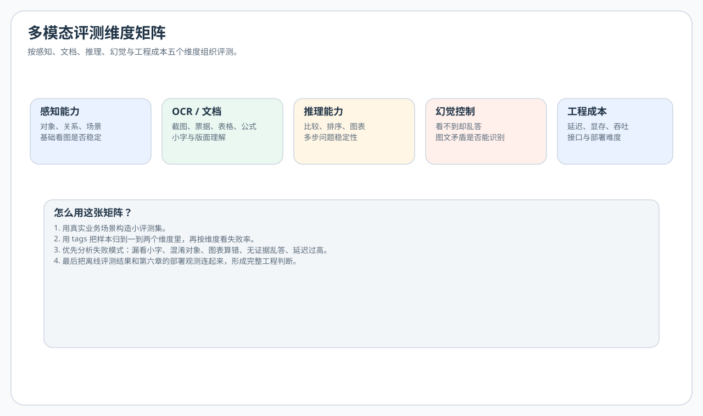

# 第五章 评测体系与工程选型

本章回答两个问题：怎样判断图文回答是否正确，以及怎样在相同任务上比较候选模型。可以直接评测现成 API 或开源模型，不要求先完成第四章微调；做过微调时，使用独立评测样本比较前后变化。

本章先确定任务与评分规则，再组织数据、调用模型和汇总结果。第六章进一步解释延迟与服务链路，第七章提供最小调用示例。

## 一、为什么直接用现成模型，也不能跳过评测

很多学习者刚接触多模态时，最容易陷入的误区就是“找总分最高的模型”。但在真实场景里，模型选择通常取决于：

- 任务类型
- 响应速度
- 显存预算
- 中文表现
- OCR 能力
- 是否支持多图、多轮、长上下文
- 推理接口和部署难度

因此，选型需要与目标任务匹配的样本和评分规则。

## 二、评测多模态模型时，至少要分五个维度

### 1. 感知能力

模型能不能看懂基本场景，识别关键对象和关系。

### 2. OCR / 文档理解能力

能不能读取截图、发票、PPT、网页、图表、公式、表格等复杂内容。

### 3. 推理能力

面对比较、排序、数数、图表归纳、多步问题时是否稳定。

### 4. 幻觉控制

当图中不存在某个元素时，模型会不会一本正经地编造。

### 5. 工程成本

包括：

- 显存和吞吐
- 首 token 延迟
- 服务稳定性
- 接口易用性

其中，感知、OCR、推理、幻觉多半要在**离线评测集**里看；工程成本则和 [第六章](../chapter6/第六章%20推理部署与%20Serving.md) 的部署观测一一对应（首 token 延迟、平均耗时、显存峰值、错误率、典型失败样例）。先确定评分目标，再据此设计日志和监控字段。

<div align="center">
  
</div>

### 写一条评测样本时，尽量做到

- **可判定**：你自己或团队能说清“怎样算对”，避免只有语感没有标准。
- **可复现**：固定图片版本与问题表述；预处理（缩放、切块）变更要单独记录为新的评测条件，保留原始样本版本以便配对比较。
- **可归类**：用 `tags` 把样本归到五维里的一两类，便于按维度看失败率。
- **有对照**：能写 `reference` 就写；开放问答也可写“必须包含的关键词”，便于脚本粗筛（最终以人工为准）。

### 从任务定义到评分

票据金额抽取可以先规定输出为数值字符串，再按约定处理货币符号和小数位。格式合法与金额正确要分别记录；整段描述包含参考短语，也可能同时否定该短语，不能只靠子串判断答案正确。

不同任务需要不同分母。以“是否有异常”的二分类为例，人工设定 100 张图片，其中 10 张有异常；模型报出 10 张异常，8 张正确、2 张误报，同时漏掉另外 2 张异常：

| 指标 | 本例计算 | 回答的问题 |
| --- | --- | --- |
| 精确率 precision | `8/(8+2)=80%` | 报出的异常有多少是真的 |
| 召回率 recall | `8/(8+2)=80%` | 真实异常有多少被找到了 |
| 准确率 accuracy | `(8+88)/100=96%` | 全部判断中有多少正确 |

本例的 96% 准确率仍对应 20% 的异常漏检。选择指标应围绕任务代价，不能只挑较大的数字。分母为零时应报告该项无法计算，而非自动写成满分。

比较两个模型时，应对齐样本 id、图片、问题、参考答案与评分规则，保留逐条结果，并单独统计请求失败。小数据上的百分比波动可能很大，报告样本数和差异案例比只给一个总分更便于解释。当前汇总脚本提供粗粒度参考命中，不会自动完成上述任务评分或样本配对检查。

## 三、如何构建自己的场景评测集

对个人项目来说，不一定非要一开始就跑大型 benchmark。下面是一套**最小可行**做法：先圈定业务场景，再落到可跑的 JSONL 与下文统计脚本，和第十章里“小步评测迭代”的节奏也能直接接上。

这套方法对三类读者都适用：

- **只调 API 的人**：拿它来比较千问、GPT、Gemini、Claude 等在自己场景上的差异。
- **本地跑开源模型的人**：拿它来比较不同模型、不同量化、不同 prompt 的表现。
- **做过小微调的人**：拿它来比较微调前后是否真的有收益，而不是只看训练 loss。

例如，如果你要做“截图助手”，可以准备：

- 20 张网页截图
- 20 张 IDE 报错截图
- 20 张后台系统表单截图
- 20 张中文界面弹窗

然后设计一组固定问题：

- 这张图在说什么？
- 是否出现错误信息？
- 关键按钮是什么？
- 需要用户下一步做什么？

这些样本用于覆盖预期场景，数量应随任务范围和可获得数据调整。

### 场景评测集 JSONL 长什么样

本仓库的 `docs/chapter5/code/eval_vlm_dataset.py` 约定每行一条 JSON，至少包含 `image`（相对或绝对路径）和 `question`。建议同时写上 `id`、`reference`（可选，便于人工或自动核对）、`tags`（如 `ui`、`ocr`、`chart`），方便按类型统计失败率：

```json
{"id":"eval-001","image":"images/sample_ui.png","question":"这张截图的主要功能区域是什么？","reference":"界面主要展示了任务列表和操作按钮。","tags":["ui","description"]}
```

跑完脚本后会得到 `eval_results.jsonl`，每行多出来 `prediction`、`status`（`ok` / `error`）、`elapsed_seconds` 等字段，可直接用来做汇总（见下文“跑完脚本后”）。

## 四、典型 benchmark 应该怎么看

公开 benchmark 的价值在于帮助你建立“能力分类”意识，而不是只看分数。

常见多模态 benchmark 可以先粗分成：

- 综合理解类
- OCR / 文档类
- 数学与图表推理类
- 多学科推理类
- 幻觉与事实一致性类

评测时更值得关注的是：

1. 这个 benchmark 的输入分布是否接近你的场景？
2. 它更偏感知、OCR，还是偏推理？
3. 评测方式是生成式打分，还是固定答案匹配？

### 代表性 benchmark 速查表

下表链接指向各 benchmark 的原始论文；RealWorldQA 链接为发布方说明，不能当作论文引用。版本、数据划分、提示词和评分器不同，分数不可直接混比。

| Benchmark / 原始来源 | 类别 | 一句话说明 | 适合测什么 |
|---|---|---|---|
| **[MMMU](https://arxiv.org/abs/2311.16502) / [MMMU-Pro](https://arxiv.org/abs/2409.02813)** | 多学科推理 | 大学层次图文题；Pro 加强文本捷径过滤并增加视觉输入设置 | 跨学科知识与视觉证据的结合 |
| **[MM-Vet v2](https://arxiv.org/abs/2408.00765)** | 综合 | 开放问答，增加交错图文序列理解 | 多种视觉语言能力的组合；需记录评判模型与评分协议 |
| **[OCRBench](https://arxiv.org/abs/2305.07895)** | OCR / 文档 | 文字识别、场景/文档问答、信息抽取、手写公式 | 文字相关视觉能力，不能替代完整的版面评测 |
| **[MathVista](https://arxiv.org/abs/2310.02255)** | 数学推理 | 多种视觉情境中的数学问题 | 视觉理解与数学推理 |
| **[POPE](https://arxiv.org/abs/2305.10355)** | 对象幻觉 | 对图中对象的存在性进行轮询式提问 | 对象幻觉；不覆盖所有事实错误 |
| **[HallusionBench](https://arxiv.org/abs/2310.14566)** | 幻觉 / 视觉错觉 | 用成组问题诊断语言幻觉与视觉错觉 | 图像上下文推理与回答一致性 |
| **[RealWorldQA](https://x.ai/news/grok-1.5v)** | 空间理解 | 真实图像中的空间理解问答（官方发布说明） | 现实场景中的空间关系 |
| **[MMBench / MMBench-CN](https://arxiv.org/abs/2307.06281)** | 综合 | 英文与中文版本的多能力选择题 | 多模态感知与推理；CN 是中文版本，并非整个 benchmark 仅测中文 |
| **[MMStar](https://arxiv.org/abs/2403.20330)** | 综合 | 筛选必须依赖视觉的图文选择题，检查语言捷径与数据泄漏 | 视觉带来的能力增益；不是“只有图像、没有语言”的测试 |
| **[BLINK](https://arxiv.org/abs/2404.12390)** | 视觉感知 | 深度、对应关系、多视角等 14 类感知任务 | 单图/多图细粒度感知，不限于找像素差异 |
| **[Video-MME](https://arxiv.org/abs/2405.21075)** | 视频 | 不同长度视频的多模态理解 | 视频理解；本章单图脚本不能直接复现 |
| **[CRPE](https://arxiv.org/abs/2402.19474)** | 关系理解 | All-Seeing Project V2 提出的关系探测评测 | 对象识别与对象间关系理解 |
| **[AI2D](https://arxiv.org/abs/1603.07396)** | 示意图 | 来自 *A Diagram Is Worth A Dozen Images* 的科学示意图理解任务 | 教育场景中的图示结构与问答 |

**使用建议**：不要一次性跑所有 benchmark。先选 2-3 个和你场景最相关的，跑通后再扩展。个人项目最常用组合：**MMBench-cn**（中文综合）+ **OCRBench**（文档）+ **POPE**（幻觉）。

## 五、模型选型的一个实用原则：先看失败模式

与其只看“最好答案”，不如优先看模型怎么失败。因为很多业务问题都是在失败模式里暴露的。

建议重点观察：

- 遇到小字时是否直接忽略
- 遇到多对象时是否混淆
- 遇到复杂表格时是否漏列
- 遇到不存在的信息时是否编造
- 遇到中文 UI 时是否术语漂移

如果一个模型在你的关键场景里失败方式不可控，它就不适合作为主力方案。

## 六、选型时最好做一张比较表

| 项目 | 模型 A | 模型 B | 模型 C |
| --- | --- | --- | --- |
| 中文自然图像问答 |  |  |  |
| 中文 OCR / 截图 |  |  |  |
| 图表推理 |  |  |  |
| 延迟 |  |  |  |
| 显存占用 |  |  |  |
| 接口易用性 |  |  |  |
| 可本地部署 |  |  |  |
| 多图输入支持 |  |  |  |

这张表不需要一开始就很精细，但它能帮助你避免“凭印象选模型”。

## 七、面向场景的选型建议

### 1. 截图助手 / 界面理解

优先看：

- OCR 稳定性
- 中文界面理解
- 小字和图标识别
- 长图处理方式

### 2. 文档抽取

优先看：

- 版面理解
- 表格抽取
- 字段一致性
- JSON 输出稳定性

### 3. 电商内容生成

优先看：

- 商品图感知
- 生成文案的可控性
- 风格一致性
- 幻觉控制

### 4. 多模态 Agent

优先看：

- 多轮稳定性
- 对工具结果的融合能力
- 是否支持多图输入
- 延迟是否可接受

## 八、工程侧不要忽视的指标

很多教程只讲“准确率”，但工程里还有几项很关键：

- 首 token 延迟
- 平均响应时长
- 峰值显存
- 并发能力
- 图像上传和编码耗时
- 服务异常时的重试策略

这些指标往往直接决定系统能不能上线。

## 九、第一次做模型比较，建议这么来

如果你现在就要开始实践，可以这样做。不管你比较的是两个现成 API，还是“基座模型 vs 你自己的微调版”，流程都一样：

1. 选 2 到 3 个你能实际调用的模型。
2. 自己做 30 到 50 条小型测试集。
3. 固定 prompt 和问题模板。
4. 比较输出质量、稳定性和速度。
5. 记录典型错误样例。

这轮小样本比较用于发现明显错误，后续可按错误类型和实际输入分布补充样本。

## 十、实战：跑一个最小评测脚本

配套文件：

- `docs/chapter5/code/eval_vlm_dataset.py`
- `docs/chapter5/code/sample_eval_dataset.jsonl`
- `docs/chapter5/code/create_placeholder_images.py`（生成 JSONL 引用的占位图，避免一上来就 `Image not found`）
- `docs/chapter5/code/requirements.txt`
- `docs/chapter5/code/.env.example`

脚本读取样本，发送图文请求，并保存输出与耗时。

使用前确认服务支持脚本采用的 Chat Completions 图像输入格式。现成模型和自行微调的模型都可通过兼容服务接入；输出质量需按本章的评分规则另行检查。

### 可以这样使用

0. （首次）在 `docs/chapter5/code` 下执行 `python create_placeholder_images.py`，或自备图片并保证路径与 JSONL 一致。占位图只是纯色块，**测业务意义需换真实截图**。
1. 把 `sample_eval_dataset.jsonl` 改成你自己的图片和问题。
2. 把 `docs/chapter5/code/.env.example` 复制为同目录 `.env`，再配置 OpenAI 兼容接口地址与模型名称；脚本会自动读取。若你暂时不想建 `.env`，也可以直接在终端里逐行写：

```powershell
$env:OPENAI_BASE_URL="你的真实接口"
$env:OPENAI_API_KEY="你的真实密钥"
$env:MODEL_ID="你的真实模型名"
$env:DATASET_PATH="sample_eval_dataset.jsonl"
$env:OUTPUT_PATH="eval_results.jsonl"
```

3. 运行 `eval_vlm_dataset.py` 批量请求模型。
4. 观察输出结果，并人工记录：
   - 是否答对
   - 是否答非所问
   - 是否出现幻觉
   - 哪类图片最容易失败

```powershell
cd docs/chapter5/code
python create_placeholder_images.py
pip install -r requirements.txt
$env:OPENAI_BASE_URL="你的真实接口"
$env:OPENAI_API_KEY="你的真实密钥"
$env:MODEL_ID="你的真实模型名"
$env:DATASET_PATH="sample_eval_dataset.jsonl"
$env:OUTPUT_PATH="eval_results.jsonl"
python eval_vlm_dataset.py
```

Linux / macOS 可将上述 PowerShell 环境变量行换成（示例）：

```bash
export OPENAI_BASE_URL=http://127.0.0.1:8000/v1
export OPENAI_API_KEY=EMPTY
export MODEL_ID=your-vlm
export DATASET_PATH=sample_eval_dataset.jsonl
export OUTPUT_PATH=eval_results.jsonl
```

也支持**命令行参数**（与第四章 `prepare_dataset_manifest.py` 一致，便于在仓库根目录执行；未传的项仍读环境变量）：

```bash
python docs/chapter5/code/eval_vlm_dataset.py -h
python docs/chapter5/code/eval_vlm_dataset.py --dataset docs/chapter5/code/sample_eval_dataset.jsonl --output docs/chapter5/code/eval_results.jsonl --base-url http://127.0.0.1:8000/v1 --model your-vlm
```

### 跑完脚本后：结果样例与粗粒度统计

`eval_results.jsonl` 中单条结果可能类似：

```json
{"id": "eval-001", "question": "...", "reference": "...", "tags": ["ui"], "prediction": "界面左侧是导航，右侧是任务列表。", "status": "ok", "elapsed_seconds": 1.234}
```

若你写了 `reference`，可以用极简规则做一次“是否命中参考答案”的统计（例如去空白、转小写后判断是否包含关键词；开放问答只能当粗筛，最终以人工为准）：

```python
import json
from pathlib import Path

path = Path("docs/chapter5/code/eval_results.jsonl")
ok = err = 0
hit = miss = 0
for line in path.read_text(encoding="utf-8").splitlines():
    if not line.strip():
        continue
    row = json.loads(line)
    if row.get("status") != "ok":
        err += 1
        continue
    ok += 1
    ref = (row.get("reference") or "").strip().lower()
    pred = (row.get("prediction") or "").strip().lower()
    if ref and ref in pred:
        hit += 1
    elif ref:
        miss += 1

print(f"status_ok={ok}, status_error={err}, rough_ref_hit={hit}, rough_ref_miss={miss}")
```

也可用仓库内 **`docs/chapter5/code/summarize_eval_results.py`**（标准库）直接汇总：单文件会打印错误率、粗粒度参考命中率、耗时均值/中位数，以及按 `tags` 分桶；多文件对比可加 `--compare` 与 `--markdown`；可加 **`--write 路径.md`** 把输出写成 UTF-8 文件（终端编码异常时尤便）。尚未调用真实接口时，可用同目录下的 **`sample_eval_results_output.jsonl`**（人工构造的格式样例，非模型实测结果；参考答案与输入集一致）试跑汇总脚本。

把同一份 `DATASET_PATH` 分别换成模型 A、模型 B 跑两遍，对比 `status_error` 比例和 `rough_ref_hit`，就能在**你自己的截图分布**上得到一张小对比表，比只看公开榜更有指导意义。示意：

| 指标（同一套 JSONL） | 模型 A | 模型 B |
| --- | --- | --- |
| 请求失败率 `status=error` | 2% | 0% |
| 粗粒度参考命中（含关键词） | 12/20 | 15/20 |
| 平均耗时（秒） | 1.1 | 2.4 |

表中数字仅为举例；你真实填表时，建议再单列“典型幻觉样例”链接到具体 `id`，方便和团队对齐失败模式。

## 十一、章末练习

### 必做（约 20 分钟）

1. 设计一个 10 条样本的小型评测集，覆盖至少 3 类任务（可用 `tags` 区分）。
2. 解释为什么“失败模式”比“最高分”更适合指导工程选型。

### 进阶（约 40 分钟）

1. 为你的目标场景列出 5 个你最关心的指标，并说明各自对应离线还是线上观测。
2. 用本章给出的比较表，实际比较 2 个你能调用的模型（至少各跑一遍 `eval_vlm_dataset.py`）。

### 挑战（1～2 小时）

1. 为每条失败样例建立“`id` → 失败类型（漏看/幻觉/答非所问）”的标注，并统计各类型占比。
2. 写半页“评测字段如何进第六章日志”：例如请求里带 `eval_id`、响应里带 `latency_ms`，便于线上对照离线集。

## 十二、本章小结

- 选多模态模型不能只看总榜分数，必须按任务拆能力。
- 先构建小而准的场景评测集，再决定模型和部署方案。
- 失败模式比单次高分更有参考价值。

你在本章定下的五维验收口径，会直接变成 **第六章**要埋的日志与观测字段；下面从“离线快照”走到“线上可复现、可对照”。

## 原始来源与深入学习

- **先读方法**：从上表挑一个与你任务匹配的原论文，重点看数据构建、测试划分、评分协议和局限性，而非只抄排行榜。POPE 适合理解对象幻觉，MMStar 适合理解“不给图片也能答对”的评测捷径。
- **再看实现（官方工具，不是原始论文）**：[VLMEvalKit](https://github.com/open-compass/VLMEvalKit) 提供多种 benchmark 的评测入口；运行前固定工具版本、模型版本和数据版本。
- **与本仓库的边界**：本章 JSONL 脚本是场景小评测入口，关键词/答案匹配只是粗筛，不等同于上表论文的官方评分，也不产生可直接与榜单比较的分数。

## 十三、章节跳转

- 上一篇：[第四章 数据、训练与微调](../chapter4/第四章%20数据、训练与微调.md)
- 下一篇：[第六章 推理部署与 Serving](../chapter6/第六章%20推理部署与%20Serving.md)
- 配套代码：[code 目录](https://github.com/datawhalechina/start-mllm/tree/main/docs/chapter5/code)（仓库路径 `docs/chapter5/code`）
