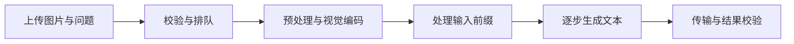

# 第六章 推理部署与 Serving

第五章讨论如何判断输出质量，本章讨论一次请求怎样被处理，以及服务变慢或出错时如何定位。前置是理解图像预处理、视觉 token 和文本生成；尚未调用过模型时，可以先读第七章，再回来看本章的服务链路。

## 一、把一次请求拆成可观察的阶段

Serving 指把模型推理组织成可供应用调用的服务。除模型计算外，还涉及请求接收、排队、输入校验、设备资源、结果传输与错误处理。使用远端 API 时，部分环节由服务商管理；自行部署时，这些职责需要由自己的服务承担。

处理输入前缀通常称为 **prefill**，模型读取视觉与文本条件并建立相应缓存；后续逐 token 生成称为 **decode**。这是理解成本的分解方式，实际引擎可能并行、批处理或复用缓存，不能把图中阶段直接等同于某个实现的线程。

例如同一张票据离线能读出金额，在线却读错，应先比较收到的图片、缩放结果、模板和模型版本。若证据相同，再比较生成配置和输出差异。仅凭回答质量下降，无法确定是模型、链路还是输入分布变化。

## 二、选择调用方式与服务后端

本地库调用和远端接口调用是应用接入方式；推理引擎则是实现服务后端的一种选择。使用 OpenAI 兼容接口时，后面也可能运行着这些引擎，三者不是互斥的模型类型。

### 1. 直接用 `Transformers` 本地推理

优点：

- 最直观
- 方便学习模型输入输出结构
- 适合做单机实验和最小 Demo

局限：

- 并发能力一般
- 服务化能力需要自己补
- 大模型场景下资源利用不一定最好

### 2. 用 OpenAI 兼容接口调用服务

优点：

- 上层应用接入简单
- 方便和现有聊天框架、Agent 框架整合
- 可以替换底层服务而不大改业务代码

局限：

- 需要服务端正确支持多模态 content schema
- 不同服务实现细节可能略有差异

### 3. 自建后端时选择推理服务框架

下表列出三种推理引擎及启动示例。运行前，按所安装版本的官方文档确认模型支持、启动参数和硬件要求：

| 引擎 | 核心特点 | 多模态支持 | 最小启动命令示例 |
|---|---|---|---|
| **vLLM** | [PagedAttention](https://arxiv.org/abs/2309.06180)：分页管理 KV Cache | Qwen2.5-VL、LLaVA、InternVL 等 | `vllm serve Qwen/Qwen2.5-VL-3B-Instruct --dtype bfloat16` |
| **SGLang** | [RadixAttention](https://arxiv.org/abs/2312.07104)：复用共享前缀的 KV Cache | Qwen2.5-VL、LLaVA 等 | `python -m sglang.launch_server --model-path Qwen/Qwen2.5-VL-3B-Instruct` |
| **LMDeploy** | [官方部署工具](https://lmdeploy.readthedocs.io/en/latest/multi_modal/qwen2_5_vl.html)，按模型选择支持的后端 | 原生支持 Qwen-VL、InternVL 系列 | `lmdeploy serve api_server Qwen/Qwen2.5-VL-3B-Instruct` |

**选型建议**：先核对目标模型与多模态接口支持，再在相同硬件、输入图像、上下文长度和并发下测首 token 延迟、吞吐与峰值显存。PagedAttention 和 RadixAttention 是机制说明，不能推出某引擎在所有场景下最快。

这类方案适合：

- 模型较大
- 并发较高
- 需要统一管理多模型

自建服务时，可先按第七章确认模型输入输出，再选择兼容引擎启动服务，最后连接第八章 Demo。使用已有 API 的读者可以跳过自建后端，直接检查请求格式与接口能力。

## 三、资源与性能指标怎样解释

### 显存和输入预算

显存包含模型权重、视觉与语言计算的中间状态、KV 缓存和运行时开销。视觉 token 增多可能增加前缀处理与缓存成本；最终数量还受模型的缩放、切块和压缩策略影响。估算方法见 [Chapter 0](../chapter0-环境准备.md)，不能只按模型名称中的参数量决定能否运行。

### 延迟、吞吐和并发

| 指标 | 含义 | 比较时需要固定或说明 |
| --- | --- | --- |
| 端到端延迟 | 从请求发起到结果接收完成的时间 | 是否包含上传、排队和后处理 |
| 首 token 延迟（TTFT） | 从约定起点到第一个输出 token 可见的时间 | 客户端或服务端计时；是否流式输出 |
| 生成速度 | decode 阶段单位时间生成的 token 数 | token 计数方式、首 token 是否计入 |
| 吞吐 | 单位时间完成的请求数或 token 数 | 两者不能混用，需说明负载与统计窗口 |
| 并发 | 同时在处理或等待的请求数量 | 排队与执行的统计范围 |

下面是**人为设定的计时示例**：请求发出后 0.8 秒收到首 token，2.8 秒收到第 40 个也是最后一个 token。端到端延迟为 2.8 秒，TTFT 为 0.8 秒；按首 token 之后的 39 个生成间隔计算，平均速度为 `39/(2.8-0.8)=19.5 token/s`。如果用 `40/2.8`，得到的是包含首 token 等待的另一种口径，不能混作相同指标。

增加并发可能提高总吞吐，也可能增加排队和单次请求延迟。平均值会掩盖少数慢请求，因此还可观察延迟分布，例如 p95 表示约 95% 请求延迟不超过的值。不同样本量和分位数算法会影响估计，不宜从少量请求推断稳定的服务水平。

## 四、输入协议与错误处理

应用需明确每个字段的含义：图像通过 URL 还是 base64 传递，文本与图片怎样排序，模型名与 chat template 是否匹配，以及返回值是自由文本还是待解析字段。HTTP 成功只说明请求层成功，非空回答也不等于任务完成。

| 现象 | 优先检查 | 后续处理 |
| --- | --- | --- |
| 图片无法解码、字段被拒绝 | 路径、文件内容、消息结构和服务支持范围 | 修正输入后再请求 |
| 超时或限流 | 上传、排队、服务负载和接口配额 | 按服务约定限制重试与等待 |
| JSON 无法解析或字段缺失 | 输出约定与实际返回 | 保留原始输出，标记失败或人工复核 |
| 回答完整但事实错误 | 原图证据、预处理、任务与模型适配 | 纳入第五章的内容评测 |

超时不一定表示服务端没有执行。重试可能产生重复调用与费用；涉及工具写操作时，还需要独立处理重复执行。教学 Demo 的异常捕获不等于已经实现服务级超时、重试和恢复策略。

## 五、怎样用日志定位问题

先给请求分配标识，再把输入版本、处理配置和结果关联起来。下面是一组用途明确的字段：

| 字段 | 排查用途 |
| --- | --- |
| request_id、样本 id | 把应用日志与评测记录对应起来 |
| 模型与配置版本 | 判断权重、模板或生成参数是否变化 |
| 图片摘要、处理后尺寸、切块信息 | 检查是否丢失内容或改变输入规模 |
| 各阶段耗时、状态和错误类型 | 区分上传、排队、推理和解析问题 |
| 受控保存的输入与输出记录 | 回放具体失败案例 |

日志无需默认复制全部用户图片和问题。根据复现需要保存必要内容，避免记录密钥；涉及个人或业务数据时明确访问范围与保留期限。仅记录文件名也可能不足以区分图片版本，可以关联内容摘要或受控数据记录。

客户端总耗时不能自动拆出服务端视觉编码时间。远端 API 没有提供阶段指标时，应标为不可观测，不用估计值填充日志。第五章脚本记录请求结果和总耗时；排队、视觉编码等阶段耗时需要服务端额外记录。

## 六、从单模型到路由

首次使用可以直接接已有 API，也可以在本地运行模型。需要让多个应用共享后端时，再考虑服务封装；需要交互界面时接第八章 Demo。不存在所有读者都必须先本地部署再调用 API 的顺序。

只有在任务差异确实需要时，再引入模型路由。例如文档抽取和自然图像描述可能使用不同模型；路由本身也会误判，应保留所选后端与原因。统一接口可以降低应用修改成本，但不同后端的图像预算、工具调用和输出行为仍需分别验证。

## 七、把一次失败接回离线评测

假设票据总金额在原图可见，但应用把图片缩得很小。可以沿以下证据解释问题：原图和离线配置能保留数字；在线预处理后的数字已模糊；同一模型在这两种输入上的输出不同。这支持“预处理影响结果”的判断，但仍需更多同类样本判断影响范围。

修正后，将该样本及预处理配置加入固定对照，检查是否恢复字段正确性，以及是否增加耗时与成本。第五章负责质量判定，第七章提供调用入口，第八章提供用户界面；本章把它们关联到同一请求和配置记录。

## 八、章末练习

**动机**：部署章要练的是“问题可定位”；练完你能把延迟、错误率拆到预处理、协议、模型哪一段，并与第五章离线结论对照。

### 必做（约 15 分钟）

1. 比较“本地 `Transformers` 推理”和“OpenAI 兼容接口”两种方式的优缺点。
2. 处理长截图时，哪些任务适合整图缩放，哪些任务需要保留更高的局部清晰度？（可结合 [Extra03](../Extra-Chapter/Extra03-长图处理与切块策略专题.md) 思考）

### 进阶（约 30 分钟）

1. 设计一个最小日志字段集合，用于排查多模态请求问题（至少包含：时间、模型、图片标识、问题摘要、耗时、错误码）。

### 挑战（1 小时左右）

1. 为你准备做的 Demo 画一个简单服务链路图，并标出“最可能放大第五章离线结论偏差的两个环节”（常见是预处理与协议）。

## 原始论文与部署文档

- **论文**：Kwon 等，*Efficient Memory Management for Large Language Model Serving with PagedAttention*（2023，[原文](https://arxiv.org/abs/2309.06180)）。结合第二节理解 KV Cache 的分页管理，以及它怎样减少缓存内存浪费。
- **论文**：Zheng 等，*SGLang: Efficient Execution of Structured Language Model Programs*（2023/2024，[原文](https://arxiv.org/abs/2312.07104)）。重点看 RadixAttention 的前缀复用与适用负载。
- **官方实现文档**：[vLLM 多模态输入](https://docs.vllm.ai/en/stable/features/multimodal_inputs/)、[SGLang 视觉接口](https://docs.sglang.io/docs/basic_usage/openai_api_vision)、[LMDeploy Qwen2.5-VL 部署](https://lmdeploy.readthedocs.io/en/latest/multi_modal/qwen2_5_vl.html)。查输入 schema、模型支持及启动选项，避免把论文与软件版本说明混用。

## 九、章节跳转

- 上一篇：[第五章 评测体系与工程选型](../chapter5/第五章%20评测体系与工程选型.md)
- 下一篇：[第七章 动手跑通你的第一个 VLM](../chapter7/第七章%20动手跑通你的第一个%20VLM.md)
- 延伸专题：[Extra03 长图处理与切块策略专题](../Extra-Chapter/Extra03-长图处理与切块策略专题.md)
