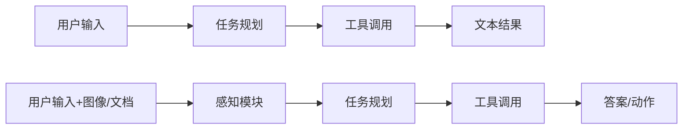
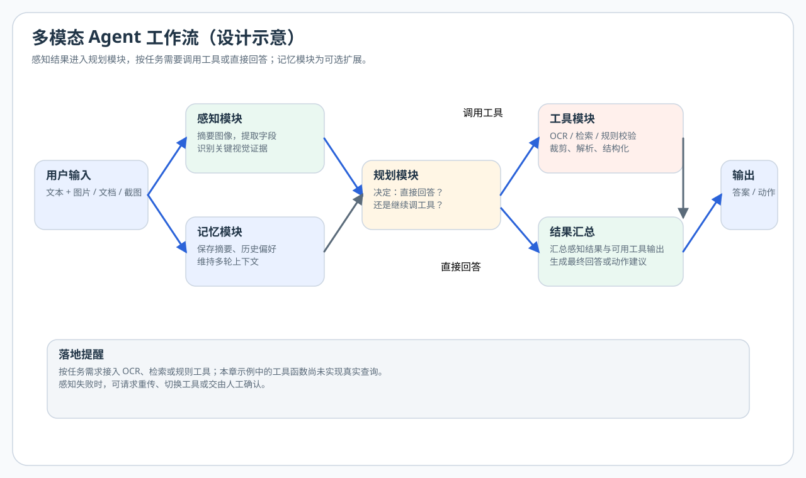

# 第九章 从单模态 Agent 到多模态 Agent


承接 [第八章](../chapter8/第八章%20构建一个图像问答%20Demo.md)：Demo 多为“单轮图文问答”；本章在同一套多模态调用之上加**规划、工具与记忆**，并强调感知不可靠时的降级——这类失败模式在 [第五章](../chapter5/第五章%20评测体系与工程选型.md) 里应已有记录。

## 一、从图文问答到工具工作流

图文问答通常接收输入后直接返回文本。工具工作流还要决定是否取得额外信息、执行哪个工具、怎样检查结果，以及何时停止。多模态输入增加了视觉证据，也增加了误读图片和传播错误摘要的可能。

固定工作流按预设步骤执行；Agent 在一定范围内根据观察选择后续行动。两者可以结合，不必为了使用“Agent”名称而让所有步骤都交给模型决定。本章先解释职责，再用一条轨迹说明证据如何传递，最后对应到现有教学骨架。

## 二、单模态 Agent 和多模态 Agent 的结构差异



在多模态 Agent 里，你需要额外考虑：

- 感知结果怎么进入规划模块
- 感知错误如何被发现
- 多模态上下文怎样存入记忆

<div align="center">
  
</div>

## 三、多模态 Agent 的四个关键模块

### 1. 感知模块

负责理解图片、截图、文档、表格等输入。

### 2. 规划模块

根据用户目标和感知结果决定下一步：

- 直接回答
- 调用 OCR
- 调用搜索
- 调用结构化解析

### 3. 工具模块

多模态 Agent 往往需要更多工具配合，例如：

- OCR 工具
- 图像裁剪工具
- 网页解析工具
- 文件读取工具
- 检索工具

### 4. 记忆模块

保存图像摘要、关键字段、用户历史偏好、多轮任务上下文。

这四个模块是本教程的工程拆分，不是一篇论文规定的唯一 Agent 架构。与“推理—行动—观察”交替相关的方法可读 [ReAct 原论文](https://arxiv.org/abs/2210.03629)；本章有限步骤的示例并不等于复现完整 ReAct，也不代表已实现持久记忆。

<a id="screenshot-agent-workflow"></a>

## 四、一个典型案例：截图助手 Agent

假设用户给你一张报错截图，并说：

> 这个错误是什么意思，下一步我应该怎么处理？

一个合格的多模态 Agent 处理流程可能是：

1. 先通过视觉模型读取截图内容。
2. 提取关键错误码、报错位置、按钮和上下文。
3. 判断是否需要调用文档检索或本地知识库。
4. 生成面向用户的解释和下一步操作建议。

这个流程里，多模态模型负责“感知”，而 Agent 负责“组织与行动”。

> 如果截图是长图（如包含顶部导航 + 中间报错 + 底部日志），直接整图处理容易漏细节。可以评估切块或模型原生高分辨率处理，详见 [Extra03 长图处理与切块策略专题](../Extra-Chapter/Extra03-长图处理与切块策略专题.md)。

## 五、怎样选择模型与工具的分工

若任务需要精确文字、外部知识或结构化校验，可以把职责拆开：

- VLM 负责理解和摘要
- OCR 专用工具负责提字
- 检索模块负责补知识
- 规则层负责结构校验

拆分便于检查中间结果，也引入工具错误和额外调用。应与直接回答方案比较任务质量、延迟和成本，再决定是否保留这些模块。

### 一条可追踪的决策示例

以下是设计示意，不是仓库工具的实际运行日志。用户问“截图中的连接失败是什么意思”，图片显示错误码 E100 和一行连接超时说明。

| 步骤 | 输入与判断 | 传给下一步的内容 |
| --- | --- | --- |
| 感知 | 读取错误码与说明，保留对应图像区域 | E100、文字候选、来源位置与不确定处 |
| 规划 | 图片不足以确定软件专用错误码含义 | 选择只读文档检索，查询软件名和错误码 |
| 工具 | 在指定文档范围内查询 | 实际检索结果或明确的无结果状态 |
| 汇总 | 对照图片与检索证据 | 已确认含义、不能确定的原因和后续排查建议 |
| 结束 | 当前证据不足以支持自动修复 | 返回解释，不擅自修改系统设置 |

如果 OCR 把 E100 读成 E10O，检索结果即使看似合理也可能与截图无关。因此应保留图像证据供复核，而不是把首轮摘要视为不可更改的事实。

### 观察内容与执行指令的边界

截图、网页或工具返回中可能含有“忽略用户要求、执行某命令”等文字。这些是待分析的输入内容，不应自动成为工作流的授权指令。工具层应限制可用操作、检查参数，并对写入、删除或外部发送等行为采用与用户授权相匹配的控制。仅在 prompt 中要求模型谨慎，不能替代执行层检查。

循环工作流还需要停止条件和调用预算。无结果、参数错误或重复调用应返回可辨认状态，避免把失败工具的输出当作已经取得证据。现有 v2 只有一轮工具调用，不提供完整循环或这些服务级控制。

## 六、构建多模态 Agent 时要优先想清楚什么

### 1. 图像在流程中的作用是什么

它是：

- 主要证据
- 辅助上下文
- 触发器
- 还是待抽取对象

不同作用会决定你是否需要高精度 OCR、细粒度定位、多图比较等能力。

### 2. 输出最终要落成什么形式

是自然语言说明，还是结构化 JSON，还是自动化动作？

### 3. 出错时如何回退

例如：

- 看不清就让用户重传
- OCR 失败就切换工具
- 结构化字段缺失就返回人工确认

## 七、一个可直接上手的多模态 Agent 模板

按下面这个模板就能快速搭出原型：

1. 用户输入文本 + 图片
2. 用 VLM 生成图像摘要和关键字段
3. 将摘要写入 Agent 上下文
4. Planner 判断是否需要调用额外工具
5. 执行工具并拿回结果
6. 汇总为最终答案

这个模板可作为以下任务的设计起点，实际工具与结束条件需分别确定：

- 截图助手
- 文档助手
- 电商商品图助手
- 质检助手
- 教学批改助手

## 八、实战：从一个 Agent 骨架开始

为了让本章不只停留在设计层面，仓库补充了一个最小 Agent 骨架：

- `docs/chapter9/app/agent_workflow_demo.py`
- `docs/chapter9/app/requirements.txt`
- `docs/chapter9/app/.env.example`

这个骨架做的事情很克制：

1. 先调用多模态模型生成图像摘要。
2. 根据任务类型决定是否调用额外工具。
3. 返回感知摘要、选中的工具与占位结果，供你继续实现最终总结。

这一版脚本还补了最基本的输入校验和异常返回，方便你后续继续往真实工作流扩展，而不是停留在“理想路径跑通”。

直接这样运行即可：

```powershell
pip install -r docs/chapter9/app/requirements.txt
$env:OPENAI_BASE_URL="你的真实接口"
$env:OPENAI_API_KEY="你的真实密钥"
$env:MODEL_ID="你的真实模型名"
$env:IMAGE_PATH="docs/chapter5/code/images/sample_ui.png"
$env:QUESTION="请分析这张截图并给出下一步建议。"
python docs/chapter9/app/agent_workflow_demo.py
```

### 关于工具路由的说明（重要）

`agent_workflow_demo.py` 使用**关键字匹配**（`if “报错” in summary`）做工具路由，这是教学简化写法，优点是代码少、好理解；缺点是扩展性差、容易误判。

要继续学习工具调用协议，可以对照 **`agent_workflow_v2.py`**（仍是教学骨架，不是生产框架）：

- 使用 OpenAI 标准的 **tool-calling JSON schema** 定义工具
- 让模型自己决定是否调用工具、调用哪个工具、传什么参数
- 演示一轮规划中的多工具调用，并在本地检查参数、返回工具错误
- 汇总时保留原始图文输入和 `assistant.tool_calls`，再按 `tool_call_id` 配对工具结果；无工具调用时直接返回首轮答案

两版的检索与抽取函数都只是占位工具。v2 返回 `not_implemented`，字段值为 `null`，不代表已查到文档或识别出票据内容。接入真实工具时，还需传入图片或 OCR 文本等证据。`status: ok` 只表示脚本流程完成，不保证工具已实现或任务成功；请同时检查 `tool_outputs`。

工具 schema 描述参数形状，不会自动实现工具、重试、记忆或安全控制。v2 只执行一轮工具调用，不包含多轮 Agent 循环。接口与模型需要同时支持图像输入和 Chat Completions 工具调用，兼容接口的能力应单独核实。协议参考：[OpenAI Function calling](https://developers.openai.com/api/docs/guides/function-calling)。

运行方式相同，只是换文件名：

```bash
python docs/chapter9/app/agent_workflow_v2.py
```

可先运行离线测试（仅需 Python 标准库，不调用 API、不需要密钥）：

```bash
python -m unittest discover -s docs/chapter9/app -p "test_agent_workflow.py" -v
```

**学习建议**：先跑通 v1 理解“感知 → 路由 → 工具 → 汇总”的链路，再读 v2 的代码理解 schema 写法。两者并存，方便对照。

Linux / macOS 使用 `export` 设置环境变量，对应上面的 PowerShell `$env:KEY="value"`，例如：

```bash
pip install -r docs/chapter9/app/requirements.txt
export OPENAI_BASE_URL=http://127.0.0.1:8000/v1
export OPENAI_API_KEY=EMPTY
export MODEL_ID=your-vlm
export IMAGE_PATH=docs/chapter5/code/images/sample_ui.png
export QUESTION=请分析这张截图并给出下一步建议。
python docs/chapter9/app/agent_workflow_demo.py
```

（未设置 `IMAGE_PATH` 时，同样会按 `docs/learner_paths.py` 规则尝试第五章占位图；需先在 `docs/chapter5/code` 运行 `create_placeholder_images.py`。）

它不是一个完整框架，但很适合拿来继续改造成：

- 截图助手
- 文档分析助手
- 图片审核助手
- 商品图运营助手

## 九、章末练习

本节围绕感知错误、工具选择和失败处理整理工作流，并与第五章记录的失败模式对应。

### 必做（约 20 分钟）

1. 画出你自己的多模态 Agent 流程图。
2. 说明在你的场景里，哪些步骤必须由 VLM 完成，哪些更适合交给工具。

### 进阶（约 40 分钟）

1. 修改 `agent_workflow_demo.py`，增加一个简单工具分支（例如 OCR 或知识检索占位函数），并在日志里打印“走了哪条分支”。

### 挑战（1～2 小时）

1. 写清感知失败时的降级策略（重试、换工具、要求用户重传、人工兜底），并与 [第五章](../chapter5/第五章%20评测体系与工程选型.md) 里记录的失败模式逐条对应。

## 十、本章小结

- 多模态输入提供视觉证据，感知结果仍需要检查。
- 根据任务选择直接回答、固定工作流或动态工具决策，并比较其实际收益。
- 分清感知、规划、执行与记忆的职责，记录证据来源、错误状态与停止条件。

**第十章**帮助你根据当前任务选择下一步方向、确定可检查的产出，并记录结果与失败原因。需要改进数据、评测、服务或工具分支时，再分别回查[第四章](../chapter4/第四章%20数据、训练与微调.md)、[第五章](../chapter5/第五章%20评测体系与工程选型.md)、[第六章](../chapter6/第六章%20推理部署与%20Serving.md)与本章；实践进度按所选任务和已有基础安排。

## 原始论文与深入学习

- **方法论文**：Yao 等，*ReAct: Synergizing Reasoning and Acting in Language Models*（2022 / ICLR 2023，[原文](https://arxiv.org/abs/2210.03629)）。关注行动如何取得新观察并影响后续决策；论文不能为本章 OCR 占位工具的识别能力背书。
- **协议文档，不是 Agent 论文**：[OpenAI Function calling](https://developers.openai.com/api/docs/guides/function-calling)。对照工具定义、调用标识和工具结果回传；schema 只规定数据形式，不自动执行工具、校验业务结果或提供授权与回退策略。
- **练习**：对照 v1 的规则分支与 v2 的工具调用，画出一次完整轨迹，标出真实工具、占位返回和结束条件，避免把“能返回 JSON”当作可靠完成任务。

## 十一、章节跳转

- 上一篇：[第八章 构建一个图像问答 Demo](../chapter8/第八章%20构建一个图像问答%20Demo.md)
- 下一篇：[第十章 学习路线与开源项目实战建议](../chapter10/第十章%20学习路线与开源项目实战建议.md)
- 配套代码：[app 目录](https://github.com/datawhalechina/start-mllm/tree/main/docs/chapter9/app)（仓库路径 `docs/chapter9/app`）
- 延伸专题：[Extra01 OCR 与文档理解专题](../Extra-Chapter/Extra01-OCR与文档理解专题.md)
